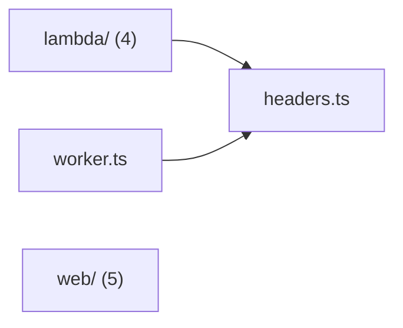

# @wren/auth-app

Role: package. Files: 11.

## Uses

- @wren/auth
- @wren/channel-email
- @wren/config
- @wren/core
- @wren/db
- @wren/ui

## Outside packages

@simplewebauthn/browser@13.3.0, @tailwindcss/vite@4.3.3, @vitejs/plugin-react@6.1.1, @wrenautomation/autobrowse@0.5.0, esbuild@0.28.2, node:child_process, node:crypto, node:fs, node:path, node:url, react-dom@19.3.0, react@19.3.0, vite@8.3.0

## Folders

Dotted: types only.

## Files

- headers.ts
- lambda/: lambda/build.mjs, lambda/http.ts, lambda/index.ts, lambda/keys.ts
- web/: web/src/App.tsx, web/src/app.css, web/src/main.tsx, web/src/next.ts, web/vite.config.ts
- worker.ts
