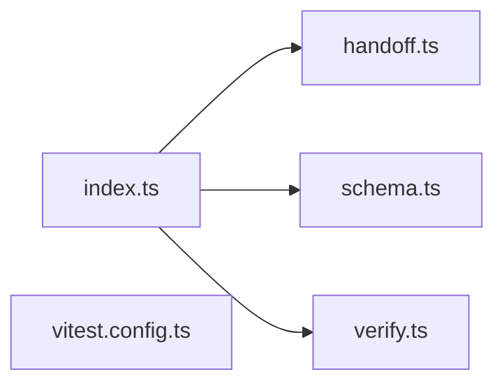

# @wren/auth

Role: package. Files: 5.

## Uses

- @wren/db

## Outside packages

@better-auth/passkey@1.7.7, better-auth@1.7.7, drizzle-orm@0.45.2, jose@6.2.12, zod@4.6.5

## Folders

Dotted: types only.

## Files

- handoff.ts
- index.ts
- schema.ts
- verify.ts
- vitest.config.ts
