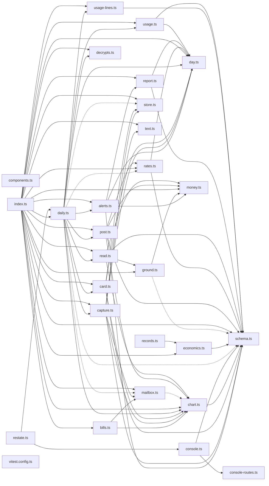

# @wren/books

Role: package. Files: 28.

## Uses

- @wren/core
- @wren/db
- @wren/llm

## Outside packages

@aws-sdk/client-cloudtrail@3.1136.0, @aws-sdk/client-cost-explorer@3.1136.0, @aws-sdk/client-s3@3.1136.0, @restatedev/restate-sdk@1.17.1, @wrenautomation/falcon@0.8.2, drizzle-orm@0.45.2, node:crypto, node:fs, node:path, zod@4.6.5

## Folders

Dotted: types only.

## Files

- alerts.ts
- bills.ts
- capture.ts
- card.ts
- chart.ts
- components.ts
- console-routes.ts
- console.ts
- daily.ts
- day.ts
- decrypts.ts
- economics.ts
- ground.ts
- index.ts
- mailbox.ts
- money.ts
- post.ts
- rates.ts
- read.ts
- records.ts
- report.ts
- restate.ts
- schema.ts
- store.ts
- text.ts
- usage-lines.ts
- usage.ts
- vitest.config.ts
