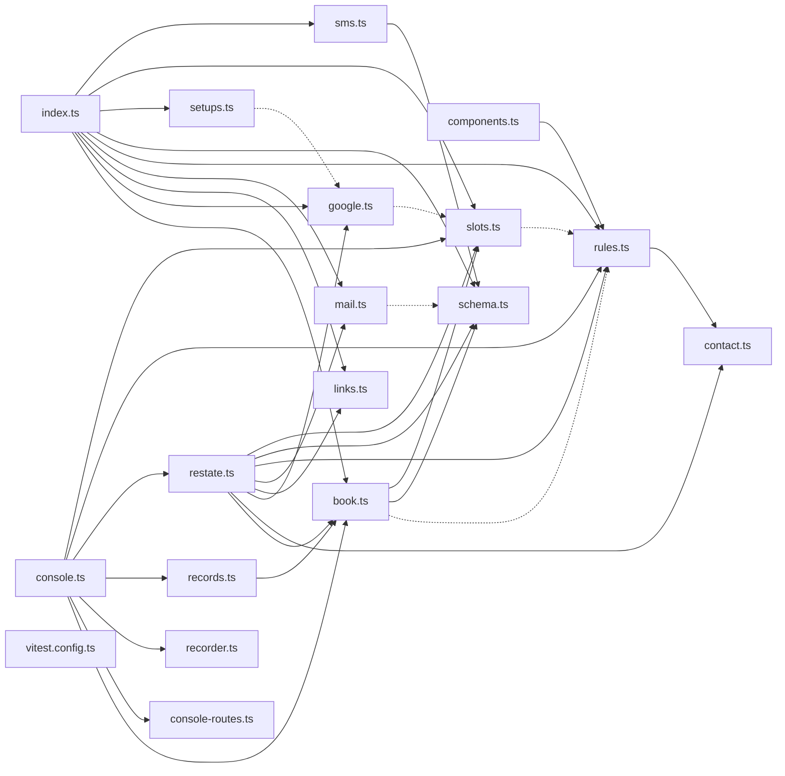

# @wren/calendar

Role: package. Files: 18.

## Uses

- @wren/channel-email
- @wren/channel-sms (types only)
- @wren/core
- @wren/db

## Outside packages

@restatedev/restate-sdk@1.17.1, @wrenautomation/autobrowse@0.5.0, drizzle-orm@0.45.2, node:crypto, zod@4.6.5

## Folders

Dotted: types only.

## Files

- book.ts
- components.ts
- console-routes.ts
- console.ts
- contact.ts
- google.ts
- index.ts
- links.ts
- mail.ts
- recorder.ts
- records.ts
- restate.ts
- rules.ts
- schema.ts
- setups.ts
- slots.ts
- sms.ts
- vitest.config.ts
