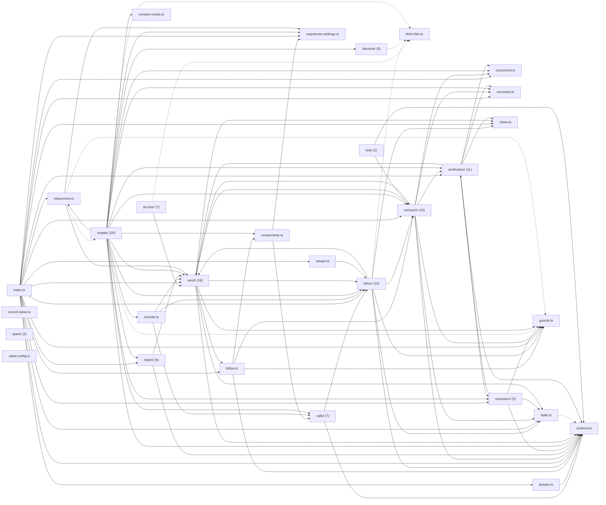

# @wren/channel-email

Role: package. Files: 132.

## Uses

- @wren/config
- @wren/core
- @wren/db
- @wren/llm
- @wren/research

## Outside packages

node:child_process, node:crypto, node:dns, node:fs, node:util

## Folders

Dotted: types only.

## Files

- access/: src/access/access.ts, src/access/console-routes.ts, src/access/console.ts, src/access/mailbox.ts, src/access/oauth.ts, src/access/schema.ts, src/access/setups.ts
- calls/: src/calls/brief.ts, src/calls/index.ts, src/calls/outcome.ts, src/calls/recording.ts, src/calls/restate.ts, src/calls/settings.ts, src/calls/site.ts
- components.ts
- concurrent.ts
- console-routes.ts
- dossier.ts
- fetch-like.ts
- follow.ts
- guards.ts
- inbox/: src/inbox/away.ts, src/inbox/bookings.ts, src/inbox/click-sync.ts, src/inbox/clicks.ts, src/inbox/disposition.ts, src/inbox/health.ts, src/inbox/inbound.ts, src/inbox/index.ts, src/inbox/instantly.ts, src/inbox/invite.ts, src/inbox/marketing-bounces.ts, src/inbox/opens.ts, src/inbox/placement.ts, src/inbox/postmaster.ts, src/inbox/reply.ts, src/inbox/sync.ts
- index.ts
- listmonk/: src/listmonk/campaign.ts, src/listmonk/client.ts, src/listmonk/index.ts, src/listmonk/setup.ts, src/listmonk/sync.ts
- outreach/: src/outreach/authoring.ts, src/outreach/compose.ts, src/outreach/facts.ts, src/outreach/fills.ts, src/outreach/index.ts, src/outreach/live.ts, src/outreach/pages.ts, src/outreach/plan.ts, src/outreach/preview.ts, src/outreach/provenance.ts, src/outreach/readable.ts, src/outreach/refresh.ts, src/outreach/review.ts, src/outreach/sequences.ts, src/outreach/templates.ts
- recontact.ts
- record-views.ts
- records.ts
- report/: src/report/index.ts, src/report/schedule.ts, src/report/send.ts, src/report/stats.ts, src/report/variants.ts, src/report/weekly.ts
- resolution/: src/resolution/index.ts, src/resolution/listed.ts, src/resolution/service.ts
- restate/: src/restate/bounce-scheduler.ts, src/restate/call-bookings.ts, src/restate/clicks-scheduler.ts, src/restate/compose-scheduler.ts, src/restate/console.ts, src/restate/digest-scheduler.ts, src/restate/disposition.ts, src/restate/inbox-scheduler.ts, src/restate/index.ts, src/restate/listmonk.ts, src/restate/marketing.ts, src/restate/newsletter.ts, src/restate/opens-scheduler.ts, src/restate/placement-scheduler.ts, src/restate/pool-scheduler.ts, src/restate/postmaster-scheduler.ts, src/restate/queue-refresh.ts, src/restate/report-scheduler.ts, src/restate/resolution.ts, src/restate/send-scheduler.ts
- schema.ts
- send/: src/send/call-times.ts, src/send/campaign-controls.ts, src/send/dates.ts, src/send/deliver.ts, src/send/gmail.ts, src/send/holidays.ts, src/send/index.ts, src/send/lead-timezone.ts, src/send/mailboxes.ts, src/send/mime.ts, src/send/policy.ts, src/send/reconcile.ts, src/send/rng.ts, src/send/roster.ts, src/send/smtp.ts, src/send/suppress.ts, src/send/tick.ts, src/send/transport.ts, src/send/tz.ts
- sequences-settings.ts
- sequences.ts
- setups.ts
- spam/: src/spam/coverage.ts, src/spam/index.ts, src/spam/spamassassin.ts
- state.ts
- test/: test/integration/compose-fixtures.ts, test/integration/inbox-fixtures.ts
- verification/: src/verification/checks.ts, src/verification/domain-health.ts, src/verification/index.ts, src/verification/lead-checks.ts, src/verification/local.ts, src/verification/mailifier.ts, src/verification/prober-health.ts, src/verification/retry.ts, src/verification/service.ts, src/verification/shared.ts, src/verification/verifier.ts
- views.ts
- vitest.config.ts
