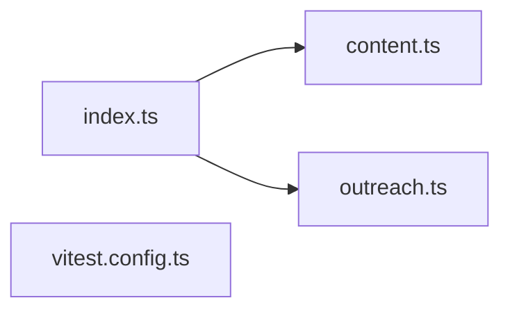

# @wren/channel-linkedin

Role: package. Files: 4.

## Uses

- @wren/core

## Outside packages

vitest@5.0.1

## Folders

Dotted: types only.

## Files

- content.ts
- index.ts
- outreach.ts
- vitest.config.ts
