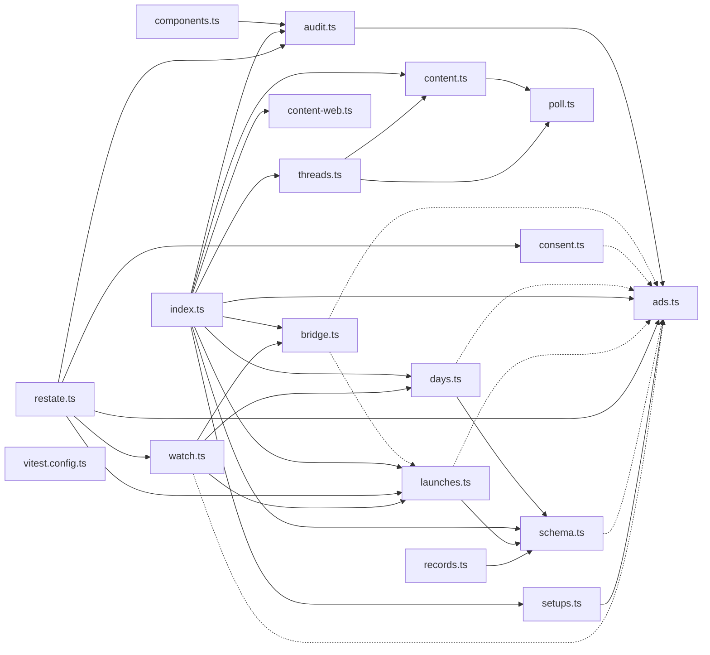

# @wren/channel-meta

Role: package. Files: 18.

## Uses

- @wren/core
- @wren/db

## Folders

Dotted: types only.

## Files

- ads.ts
- audit.ts
- bridge.ts
- components.ts
- consent.ts
- content-web.ts
- content.ts
- days.ts
- index.ts
- launches.ts
- poll.ts
- records.ts
- restate.ts
- schema.ts
- setups.ts
- threads.ts
- vitest.config.ts
- watch.ts
