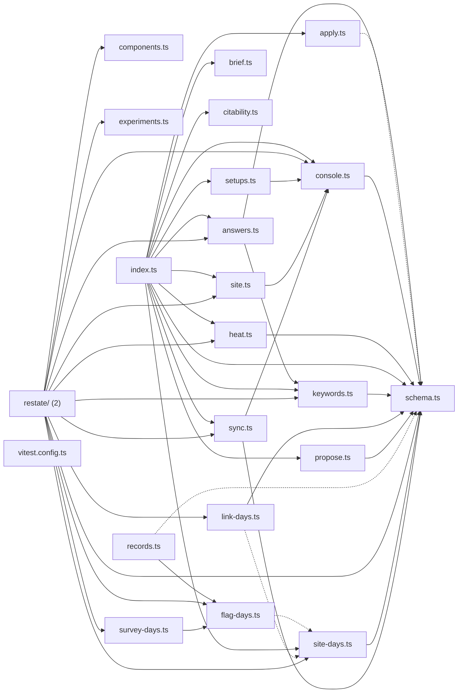

# @wren/channel-search

Role: package. Files: 23.

## Uses

- @wren/channel-email
- @wren/core
- @wren/db
- @wren/experiments
- @wren/llm
- @wren/sites

## Outside packages

@restatedev/restate-sdk@1.17.1, @wrenautomation/autobrowse@0.5.0, drizzle-orm@0.45.2, zod@4.6.5

## Folders

Dotted: types only.

## Files

- answers.ts
- apply.ts
- brief.ts
- citability.ts
- components.ts
- console.ts
- experiments.ts
- flag-days.ts
- heat.ts
- index.ts
- keywords.ts
- link-days.ts
- propose.ts
- records.ts
- restate/: src/restate/index.ts, src/restate/watch.ts
- schema.ts
- setups.ts
- site-days.ts
- site.ts
- survey-days.ts
- sync.ts
- vitest.config.ts
