# @wren/channel-sms

Role: package. Files: 46.

## Uses

- @wren/config (types only)
- @wren/core
- @wren/db
- @wren/llm
- @wren/research

## Outside packages

@restatedev/restate-sdk@1.17.1, drizzle-orm@0.45.2, libphonenumber-js@1.13.14, node:crypto, web-push@3.6.7, zod@4.6.5

## Folders

Dotted: types only.

```mermaid
flowchart LR
  nbookings_ts["bookings.ts"]
  nclassify_ts["classify.ts"]
  nclients_ts["clients.ts"]
  ncomponents_ts["components.ts"]
  nconsole_routes_ts["console-routes.ts"]
  ncontacts_ts["contacts.ts"]
  ndeliver_ts["deliver.ts"]
  nenroll_ts["enroll.ts"]
  nevents_ts["events.ts"]
  nfollow_ts["follow.ts"]
  nform_after_ts["form-after.ts"]
  nform_ts["form.ts"]
  nhealth_ts["health.ts"]
  nindex_ts["index.ts"]
  nkeyed_ts["keyed.ts"]
  nlift_ts["lift.ts"]
  nlinq_ts["linq.ts"]
  nmissed_ts["missed.ts"]
  noperator_ts["operator.ts"]
  nphone_ts["phone.ts"]
  npolicy_ts["policy.ts"]
  npool_ts["pool.ts"]
  nprovider_ts["provider.ts"]
  npush_ts["push.ts"]
  nrecords_ts["records.ts"]
  nrefusal_ts["refusal.ts"]
  nregistration_ts["registration.ts"]
  nreminders_ts["reminders.ts"]
  nrestate_["restate/ (4)"]
  nreviews_ts["reviews.ts"]
  nschema_ts["schema.ts"]
  nsettings_ts["settings.ts"]
  nsetups_ts["setups.ts"]
  nsigner_ts["signer.ts"]
  nspeed_ts["speed.ts"]
  nstats_ts["stats.ts"]
  ntelnyx_ts["telnyx.ts"]
  ntemplate_store_ts["template-store.ts"]
  ntemplates_ts["templates.ts"]
  nthreads_ts["threads.ts"]
  nwebhook_ts["webhook.ts"]
  ntest_["test/"]
  nvitest_config_ts["vitest.config.ts"]
  nclassify_ts --> ndeliver_ts
  nclassify_ts --> nrefusal_ts
  nclassify_ts --> nschema_ts
  ncomponents_ts --> nclients_ts
  ncontacts_ts --> ndeliver_ts
  ncontacts_ts --> nphone_ts
  ncontacts_ts -.-> npolicy_ts
  ncontacts_ts --> npool_ts
  ncontacts_ts --> nrefusal_ts
  ncontacts_ts --> nschema_ts
  ndeliver_ts --> npolicy_ts
  ndeliver_ts --> npool_ts
  ndeliver_ts -.-> nprovider_ts
  ndeliver_ts --> nrefusal_ts
  ndeliver_ts --> nschema_ts
  ndeliver_ts --> ntemplate_store_ts
  ndeliver_ts --> ntemplates_ts
  nenroll_ts --> nphone_ts
  nenroll_ts --> npolicy_ts
  nenroll_ts --> npool_ts
  nenroll_ts -.-> nprovider_ts
  nenroll_ts --> nrefusal_ts
  nenroll_ts --> nschema_ts
  nenroll_ts --> ntemplate_store_ts
  nenroll_ts --> ntemplates_ts
  nevents_ts --> ndeliver_ts
  nevents_ts --> nphone_ts
  nevents_ts --> npool_ts
  nevents_ts -.-> nprovider_ts
  nevents_ts --> npush_ts
  nevents_ts --> nschema_ts
  nfollow_ts -.-> nbookings_ts
  nfollow_ts --> ncomponents_ts
  nfollow_ts --> ndeliver_ts
  nfollow_ts --> npolicy_ts
  nfollow_ts --> nschema_ts
  nfollow_ts --> ntemplate_store_ts
  nfollow_ts --> ntemplates_ts
  nform_after_ts -.-> nbookings_ts
  nform_after_ts --> nform_ts
  nform_after_ts --> nphone_ts
  nform_after_ts --> npolicy_ts
  nform_after_ts -.-> nreviews_ts
  nform_after_ts --> nschema_ts
  nform_after_ts --> ntemplates_ts
  nform_ts -.-> nbookings_ts
  nform_ts --> nenroll_ts
  nform_ts --> nfollow_ts
  nform_ts --> nphone_ts
  nform_ts --> npolicy_ts
  nform_ts -.-> nprovider_ts
  nform_ts --> nschema_ts
  nform_ts --> ntemplate_store_ts
  nform_ts --> ntemplates_ts
  nhealth_ts --> nphone_ts
  nhealth_ts --> npool_ts
  nhealth_ts -.-> nprovider_ts
  nhealth_ts --> nschema_ts
  nindex_ts --> nbookings_ts
  nindex_ts --> nclassify_ts
  nindex_ts --> nclients_ts
  nindex_ts --> ncontacts_ts
  nindex_ts --> ndeliver_ts
  nindex_ts --> nenroll_ts
  nindex_ts --> nevents_ts
  nindex_ts --> nfollow_ts
  nindex_ts --> nform_after_ts
  nindex_ts --> nform_ts
  nindex_ts --> nhealth_ts
  nindex_ts --> nkeyed_ts
  nindex_ts --> nlift_ts
  nindex_ts --> nmissed_ts
  nindex_ts --> noperator_ts
  nindex_ts --> nphone_ts
  nindex_ts --> npolicy_ts
  nindex_ts --> npool_ts
  nindex_ts --> nprovider_ts
  nindex_ts --> npush_ts
  nindex_ts --> nrefusal_ts
  nindex_ts --> nregistration_ts
  nindex_ts --> nreminders_ts
  nindex_ts --> nreviews_ts
  nindex_ts --> nschema_ts
  nindex_ts --> nsettings_ts
  nindex_ts --> nsetups_ts
  nindex_ts --> nspeed_ts
  nindex_ts --> nstats_ts
  nindex_ts --> ntelnyx_ts
  nindex_ts --> ntemplate_store_ts
  nindex_ts --> ntemplates_ts
  nindex_ts --> nthreads_ts
  nindex_ts --> nwebhook_ts
  nkeyed_ts -.-> nprovider_ts
  nlift_ts --> nphone_ts
  nlift_ts --> nschema_ts
  nlinq_ts --> nprovider_ts
  nlinq_ts -.-> nschema_ts
  nlinq_ts --> ntelnyx_ts
  nmissed_ts --> nphone_ts
  nmissed_ts --> nschema_ts
  nmissed_ts --> ntemplate_store_ts
  nmissed_ts --> ntemplates_ts
  noperator_ts --> nphone_ts
  noperator_ts -.-> nprovider_ts
  noperator_ts --> nschema_ts
  nphone_ts --> nschema_ts
  npolicy_ts --> nschema_ts
  npool_ts --> nphone_ts
  npool_ts --> npolicy_ts
  npool_ts -.-> nprovider_ts
  npool_ts --> nschema_ts
  nprovider_ts --> nrefusal_ts
  nprovider_ts -.-> nschema_ts
  nprovider_ts -.-> ntemplates_ts
  npush_ts --> nschema_ts
  nrecords_ts --> nphone_ts
  nrecords_ts --> nschema_ts
  nrecords_ts --> ntemplate_store_ts
  nrecords_ts --> ntemplates_ts
  nrecords_ts --> nthreads_ts
  nregistration_ts --> npolicy_ts
  nregistration_ts -.-> nprovider_ts
  nregistration_ts --> nschema_ts
  nreminders_ts -.-> nbookings_ts
  nreminders_ts --> ndeliver_ts
  nreminders_ts --> nphone_ts
  nreminders_ts --> npolicy_ts
  nreminders_ts --> npool_ts
  nreminders_ts --> nschema_ts
  nreminders_ts --> ntemplate_store_ts
  nreminders_ts --> ntemplates_ts
  nrestate_ --> nmissed_ts
  nrestate_ --> nreviews_ts
  nrestate_ --> nclients_ts
  nrestate_ --> nconsole_routes_ts
  nrestate_ --> nphone_ts
  nrestate_ --> nrecords_ts
  nrestate_ --> nschema_ts
  nrestate_ --> nform_after_ts
  nrestate_ --> nform_ts
  nrestate_ -.-> nbookings_ts
  nrestate_ --> nclassify_ts
  nrestate_ --> ncontacts_ts
  nrestate_ --> ndeliver_ts
  nrestate_ --> nenroll_ts
  nrestate_ --> nevents_ts
  nrestate_ --> nfollow_ts
  nrestate_ --> nhealth_ts
  nrestate_ --> nlift_ts
  nrestate_ --> npolicy_ts
  nrestate_ --> npool_ts
  nrestate_ -.-> nprovider_ts
  nrestate_ --> npush_ts
  nrestate_ --> nrefusal_ts
  nrestate_ --> nregistration_ts
  nrestate_ --> nreminders_ts
  nrestate_ --> nsigner_ts
  nrestate_ --> nstats_ts
  nrestate_ --> ntemplate_store_ts
  nrestate_ -.-> ntemplates_ts
  nrestate_ --> nthreads_ts
  nreviews_ts --> nphone_ts
  nreviews_ts --> npool_ts
  nreviews_ts --> nschema_ts
  nreviews_ts --> nsetups_ts
  nreviews_ts --> ntemplate_store_ts
  nreviews_ts --> ntemplates_ts
  nsettings_ts --> nhealth_ts
  nsettings_ts --> nlinq_ts
  nsettings_ts --> nphone_ts
  nsettings_ts --> npolicy_ts
  nsettings_ts --> nprovider_ts
  nsettings_ts --> npush_ts
  nsettings_ts --> ntelnyx_ts
  nsetups_ts --> nclients_ts
  nsetups_ts -.-> nprovider_ts
  nsetups_ts --> nschema_ts
  nsigner_ts --> nclients_ts
  nsigner_ts --> nschema_ts
  nspeed_ts --> ncomponents_ts
  nspeed_ts --> nenroll_ts
  nspeed_ts --> nform_ts
  nspeed_ts --> nphone_ts
  nspeed_ts -.-> npolicy_ts
  nspeed_ts -.-> nprovider_ts
  nspeed_ts --> nrefusal_ts
  nspeed_ts --> nschema_ts
  nspeed_ts --> ntemplate_store_ts
  nspeed_ts --> ntemplates_ts
  nstats_ts --> nschema_ts
  ntelnyx_ts --> nprovider_ts
  ntelnyx_ts --> nschema_ts
  ntemplate_store_ts -.-> nprovider_ts
  ntemplate_store_ts --> nrefusal_ts
  ntemplate_store_ts -.-> nschema_ts
  ntemplate_store_ts --> ntemplates_ts
  nthreads_ts --> ndeliver_ts
  nthreads_ts --> nphone_ts
  nthreads_ts --> nschema_ts
  ntest_ --> nlift_ts
  ntest_ --> nphone_ts
  ntest_ --> npolicy_ts
  ntest_ -.-> nprovider_ts
  ntest_ --> nschema_ts
  ntest_ --> ntemplate_store_ts
  ntest_ --> ntemplates_ts
```

## Files

- bookings.ts
- classify.ts
- clients.ts
- components.ts
- console-routes.ts
- contacts.ts
- deliver.ts
- enroll.ts
- events.ts
- follow.ts
- form-after.ts
- form.ts
- health.ts
- index.ts
- keyed.ts
- lift.ts
- linq.ts
- missed.ts
- operator.ts
- phone.ts
- policy.ts
- pool.ts
- provider.ts
- push.ts
- records.ts
- refusal.ts
- registration.ts
- reminders.ts
- restate/: src/restate/answers.ts, src/restate/console.ts, src/restate/forms.ts, src/restate/index.ts
- reviews.ts
- schema.ts
- settings.ts
- setups.ts
- signer.ts
- speed.ts
- stats.ts
- telnyx.ts
- template-store.ts
- templates.ts
- test/: test/integration/fixtures.ts
- threads.ts
- vitest.config.ts
- webhook.ts
