# @wren/cli

Role: package. Files: 67.

## Uses

- @wren/books
- @wren/calendar
- @wren/channel-email
- @wren/channel-meta
- @wren/channel-search
- @wren/channel-sms
- @wren/config
- @wren/content
- @wren/core
- @wren/db
- @wren/delivery
- @wren/learn
- @wren/llm
- @wren/niches
- @wren/notes
- @wren/offers
- @wren/outreach
- @wren/pipeline
- @wren/reactivation
- @wren/research
- @wren/sites
- @wren/studio
- @wren/video
- @wren/watch
- @wren/worker

## Outside packages

@duckdb/node-api@1.5.6-r.1, @restatedev/restate-sdk-clients@1.17.1, @wrenautomation/autobrowse@0.5.0, @wrenautomation/falcon@0.8.2, @wrenautomation/models@0.8.2, @wrenautomation/weaver@0.8.2, commander@15.0.0, drizzle-orm@0.45.2, esbuild@0.28.2, node:child_process, node:crypto, node:fs, node:os, node:path, node:url, node:util

## Folders

Dotted: types only.

```mermaid
flowchart LR
  nscripts_["scripts/"]
  naccounts_ts["accounts.ts"]
  nads_ts["ads.ts"]
  nanswers_ts["answers.ts"]
  napp_reviews_ts["app-reviews.ts"]
  nargs_ts["args.ts"]
  nbooks_ts["books.ts"]
  ncalendar_ts["calendar.ts"]
  ncalls_ts["calls.ts"]
  nclient_scope_ts["client-scope.ts"]
  nclients_ts["clients.ts"]
  ncontent_ts["content.ts"]
  ncrm_ts["crm.ts"]
  ndecide_ts["decide.ts"]
  ndeliverability_ts["deliverability.ts"]
  ndelivery_ts["delivery.ts"]
  ndlq_ts["dlq.ts"]
  ndossier_ts["dossier.ts"]
  ndrafts_ts["drafts.ts"]
  nemail_ts["email.ts"]
  nenrich_ts["enrich.ts"]
  nfetch_ts["fetch.ts"]
  ngroups_ts["groups.ts"]
  nhealth_ts["health.ts"]
  nhooks_ts["hooks.ts"]
  nkeys_ts["keys.ts"]
  nlake_sync_ts["lake-sync.ts"]
  nlake_track_ts["lake-track.ts"]
  nlake_ts["lake.ts"]
  nlearn_readers_ts["learn-readers.ts"]
  nlearn_ts["learn.ts"]
  nlimits_ts["limits.ts"]
  nlistmonk_ts["listmonk.ts"]
  nloops_ts["loops.ts"]
  nmain_ts["main.ts"]
  nnewsletter_ts["newsletter.ts"]
  nnotes_ts["notes.ts"]
  nobjects_ts["objects.ts"]
  npages_ts["pages.ts"]
  npeople_ts["people.ts"]
  npipeline_ts["pipeline.ts"]
  npoll_ts["poll.ts"]
  nproducts_ts["products.ts"]
  nreach_ts["reach.ts"]
  nreview_ts["review.ts"]
  nsearch_ts["search.ts"]
  nshape_ts["shape.ts"]
  nsite_pages_ts["site-pages.ts"]
  nsites_ts["sites.ts"]
  nsms_ts["sms.ts"]
  nsocial_ts["social.ts"]
  nsop_ts["sop.ts"]
  nstudio_ts["studio.ts"]
  nstudy_ts["study.ts"]
  ntasks_ts["tasks.ts"]
  ntemplate_prune_ts["template-prune.ts"]
  ntemplates_ts["templates.ts"]
  ntouches_ts["touches.ts"]
  ntrain_ts["train.ts"]
  nvideo_ask_ts["video-ask.ts"]
  nvideo_watch_ts["video-watch.ts"]
  nvideo_ts["video.ts"]
  nwatch_ts["watch.ts"]
  nwebhooks_ts["webhooks.ts"]
  nworkflows_ts["workflows.ts"]
  nwrite_ts["write.ts"]
  nvitest_config_ts["vitest.config.ts"]
  nbooks_ts --> nsites_ts
  nclients_ts --> nargs_ts
  nclients_ts --> nproducts_ts
  ncrm_ts --> nsites_ts
  ndrafts_ts --> ncontent_ts
  nemail_ts --> nanswers_ts
  nemail_ts --> ndeliverability_ts
  nenrich_ts --> nsites_ts
  nhealth_ts --> ndelivery_ts
  nlake_sync_ts --> nlake_track_ts
  nlake_ts --> nlake_sync_ts
  nlearn_readers_ts --> nsites_ts
  nlearn_readers_ts --> nvideo_watch_ts
  nlearn_ts --> nargs_ts
  nlearn_ts --> nlearn_readers_ts
  nlearn_ts --> nvideo_watch_ts
  nmain_ts --> naccounts_ts
  nmain_ts --> nads_ts
  nmain_ts --> napp_reviews_ts
  nmain_ts --> nbooks_ts
  nmain_ts --> ncalendar_ts
  nmain_ts --> ncalls_ts
  nmain_ts --> nclient_scope_ts
  nmain_ts --> nclients_ts
  nmain_ts --> ncontent_ts
  nmain_ts --> ncrm_ts
  nmain_ts --> ndecide_ts
  nmain_ts --> ndelivery_ts
  nmain_ts --> ndlq_ts
  nmain_ts --> ndossier_ts
  nmain_ts --> ndrafts_ts
  nmain_ts --> nemail_ts
  nmain_ts --> nenrich_ts
  nmain_ts --> nfetch_ts
  nmain_ts --> ngroups_ts
  nmain_ts --> nhealth_ts
  nmain_ts --> nhooks_ts
  nmain_ts --> nkeys_ts
  nmain_ts --> nlake_ts
  nmain_ts --> nlearn_ts
  nmain_ts --> nlimits_ts
  nmain_ts --> nlistmonk_ts
  nmain_ts --> nloops_ts
  nmain_ts --> nnewsletter_ts
  nmain_ts --> nnotes_ts
  nmain_ts --> nobjects_ts
  nmain_ts --> npages_ts
  nmain_ts --> npeople_ts
  nmain_ts --> npipeline_ts
  nmain_ts --> nreach_ts
  nmain_ts --> nreview_ts
  nmain_ts --> nsearch_ts
  nmain_ts --> nshape_ts
  nmain_ts --> nsite_pages_ts
  nmain_ts --> nsms_ts
  nmain_ts --> nsocial_ts
  nmain_ts --> nsop_ts
  nmain_ts --> nstudy_ts
  nmain_ts --> ntasks_ts
  nmain_ts --> ntemplates_ts
  nmain_ts --> ntouches_ts
  nmain_ts --> ntrain_ts
  nmain_ts --> nvideo_ts
  nmain_ts --> nwatch_ts
  nmain_ts --> nwebhooks_ts
  nmain_ts --> nworkflows_ts
  nmain_ts --> nwrite_ts
  nreach_ts --> naccounts_ts
  nreach_ts --> npoll_ts
  nsearch_ts --> nsites_ts
  nshape_ts --> nargs_ts
  nshape_ts --> npipeline_ts
  nsocial_ts --> nsites_ts
  nsop_ts --> nlearn_readers_ts
  nsop_ts --> nvideo_watch_ts
  nstudio_ts --> ncontent_ts
  nstudio_ts --> nsop_ts
  nstudio_ts --> nvideo_ask_ts
  nstudio_ts --> nvideo_watch_ts
  nstudy_ts --> nargs_ts
  nstudy_ts --> nsites_ts
  ntemplates_ts --> ntemplate_prune_ts
  nvideo_ts --> nstudio_ts
  nwrite_ts --> ncontent_ts
```

## Files

- accounts.ts
- ads.ts
- answers.ts
- app-reviews.ts
- args.ts
- books.ts
- calendar.ts
- calls.ts
- client-scope.ts
- clients.ts
- content.ts
- crm.ts
- decide.ts
- deliverability.ts
- delivery.ts
- dlq.ts
- dossier.ts
- drafts.ts
- email.ts
- enrich.ts
- fetch.ts
- groups.ts
- health.ts
- hooks.ts
- keys.ts
- lake-sync.ts
- lake-track.ts
- lake.ts
- learn-readers.ts
- learn.ts
- limits.ts
- listmonk.ts
- loops.ts
- main.ts
- newsletter.ts
- notes.ts
- objects.ts
- pages.ts
- people.ts
- pipeline.ts
- poll.ts
- products.ts
- reach.ts
- review.ts
- scripts/: scripts/build.mjs
- search.ts
- shape.ts
- site-pages.ts
- sites.ts
- sms.ts
- social.ts
- sop.ts
- studio.ts
- study.ts
- tasks.ts
- template-prune.ts
- templates.ts
- touches.ts
- train.ts
- video-ask.ts
- video-watch.ts
- video.ts
- vitest.config.ts
- watch.ts
- webhooks.ts
- workflows.ts
- write.ts
