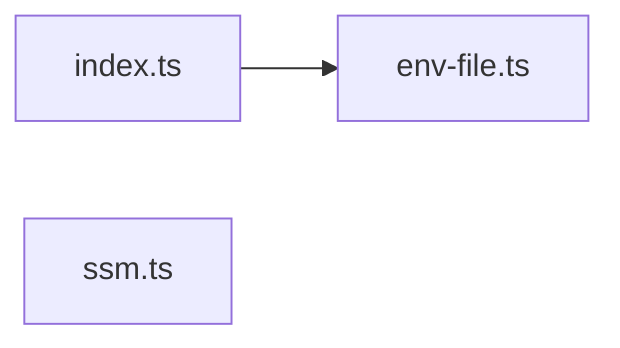

# @wren/config

Role: package. Files: 3.

## Outside packages

@aws-sdk/client-ssm@3.1136.0, node:fs, node:path, zod@4.6.5

## Folders

Dotted: types only.

## Files

- env-file.ts
- index.ts
- ssm.ts
