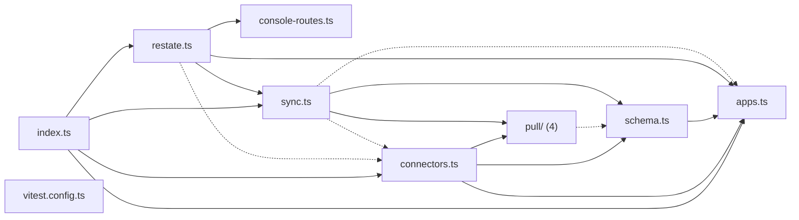

# @wren/connectors

Role: package. Files: 12.

## Uses

- @wren/core
- @wren/db

## Outside packages

node:crypto

## Folders

Dotted: types only.

## Files

- apps.ts
- connectors.ts
- console-routes.ts
- index.ts
- pull/: src/pull/hubspot.ts, src/pull/jobber.ts, src/pull/quickbooks.ts, src/pull/types.ts
- restate.ts
- schema.ts
- sync.ts
- vitest.config.ts
