# @wren/content

Role: package. Files: 125.

## Uses

- @wren/channel-sms
- @wren/core
- @wren/db
- @wren/delivery
- @wren/documents
- @wren/learn
- @wren/llm
- @wren/notes
- @wren/outreach
- @wren/payments
- @wren/research
- @wren/sites
- @wren/studio

## Outside packages

@aws-sdk/client-s3@3.1136.0, @aws-sdk/s3-request-presigner@3.1136.0, @restatedev/restate-sdk@1.17.1, @wrenautomation/autobrowse@0.5.0, drizzle-orm@0.45.2, node:crypto, node:fs, node:path, playwright-core@1.63.0, zod@4.6.5

## Folders

Dotted: types only.

```mermaid
flowchart LR
  nanalytics_["analytics/ (6)"]
  nattach_ts["attach.ts"]
  nblog_ts["blog.ts"]
  ncarousel_ts["carousel.ts"]
  nchat_["chat/"]
  ncheck_ts["check.ts"]
  nclient_reports_["client-reports/ (3)"]
  nclients_ts["clients.ts"]
  ncomponents_ts["components.ts"]
  nconnect_["connect/ (17)"]
  ncosts_ts["costs.ts"]
  ndraft_ask_ts["draft-ask.ts"]
  ndraft_calls_ts["draft-calls.ts"]
  ndraft_ts["draft.ts"]
  nfilm_check_ts["film-check.ts"]
  nfunnel_ts["funnel.ts"]
  nideas_ts["ideas.ts"]
  nideas_["ideas/ (2)"]
  ninbox_["inbox/ (9)"]
  nindex_ts["index.ts"]
  nlearn_back_ts["learn-back.ts"]
  nlessons_ts["lessons.ts"]
  nlibrary_ts["library.ts"]
  nmedia_ts["media.ts"]
  nmetrics_ts["metrics.ts"]
  nour_posts_ts["our-posts.ts"]
  nown_ts["own.ts"]
  npieces_ts["pieces.ts"]
  nplan_ts["plan.ts"]
  nplatforms_ts["platforms.ts"]
  nplaybook_ts["playbook.ts"]
  npromo_ts["promo.ts"]
  nqueue_ts["queue.ts"]
  nrecords_ts["records.ts"]
  nrestate_["restate/ (26)"]
  nreview_ts["review.ts"]
  nschema_ts["schema.ts"]
  nshape_view_ts["shape-view.ts"]
  nsite_posts_ts["site-posts.ts"]
  nslide_paint_ts["slide-paint.ts"]
  nslots_ts["slots.ts"]
  nsocial_["social/ (8)"]
  nstatus_ts["status.ts"]
  nstory_ts["story.ts"]
  nsubreddit_ts["subreddit.ts"]
  nthumbs_ts["thumbs.ts"]
  ntouches_ts["touches.ts"]
  ntrain_backfill_ts["train-backfill.ts"]
  nvideo_ask_ts["video-ask.ts"]
  nvideo_edit_ts["video-edit.ts"]
  nvideo_ts["video.ts"]
  nvoice_ts["voice.ts"]
  nwrite_ts["write.ts"]
  ntest_["test/ (7)"]
  nvitest_config_ts["vitest.config.ts"]
  nanalytics_ --> nschema_ts
  nanalytics_ --> nsocial_
  nattach_ts --> nmedia_ts
  nattach_ts --> nreview_ts
  nattach_ts -.-> nschema_ts
  nblog_ts --> nschema_ts
  ncarousel_ts -.-> ndraft_ts
  ncarousel_ts --> nideas_ts
  ncarousel_ts --> nmedia_ts
  ncarousel_ts --> nplatforms_ts
  ncarousel_ts --> nschema_ts
  ncarousel_ts --> nwrite_ts
  nchat_ --> nschema_ts
  ncheck_ts --> nplaybook_ts
  ncheck_ts --> nreview_ts
  ncheck_ts --> nschema_ts
  nclients_ts --> ncomponents_ts
  nclients_ts --> nconnect_
  nclients_ts -.-> nvoice_ts
  nconnect_ --> nplatforms_ts
  nconnect_ --> nschema_ts
  ncosts_ts --> nschema_ts
  ndraft_ask_ts --> nplatforms_ts
  ndraft_ask_ts --> nplaybook_ts
  ndraft_ask_ts --> nreview_ts
  ndraft_ask_ts --> nschema_ts
  ndraft_ts --> nlessons_ts
  ndraft_ts --> nplatforms_ts
  ndraft_ts --> nplaybook_ts
  ndraft_ts --> nschema_ts
  ndraft_ts --> nsubreddit_ts
  ndraft_ts --> nvoice_ts
  nfilm_check_ts --> nschema_ts
  nfunnel_ts --> nplatforms_ts
  nfunnel_ts --> nschema_ts
  nideas_ts --> nschema_ts
  nideas_ts -.-> nwrite_ts
  nideas_ --> nideas_ts
  nideas_ -.-> nschema_ts
  ninbox_ --> nschema_ts
  ninbox_ --> nconnect_
  nindex_ts --> nanalytics_
  nindex_ts --> nattach_ts
  nindex_ts --> nblog_ts
  nindex_ts --> ncarousel_ts
  nindex_ts --> ncheck_ts
  nindex_ts --> nclients_ts
  nindex_ts --> ncosts_ts
  nindex_ts --> ndraft_ask_ts
  nindex_ts --> ndraft_ts
  nindex_ts --> nfilm_check_ts
  nindex_ts --> nfunnel_ts
  nindex_ts --> nideas_ts
  nindex_ts --> nlearn_back_ts
  nindex_ts --> nlessons_ts
  nindex_ts --> nmedia_ts
  nindex_ts --> nmetrics_ts
  nindex_ts --> nown_ts
  nindex_ts --> npieces_ts
  nindex_ts --> nplan_ts
  nindex_ts --> nplatforms_ts
  nindex_ts --> nplaybook_ts
  nindex_ts --> npromo_ts
  nindex_ts --> nqueue_ts
  nindex_ts --> nreview_ts
  nindex_ts --> nschema_ts
  nindex_ts --> nslide_paint_ts
  nindex_ts --> nslots_ts
  nindex_ts --> nsocial_
  nindex_ts --> nstatus_ts
  nindex_ts --> ntouches_ts
  nindex_ts --> ntrain_backfill_ts
  nindex_ts --> nvideo_ask_ts
  nindex_ts --> nvideo_ts
  nindex_ts --> nvoice_ts
  nlearn_back_ts --> nfilm_check_ts
  nlearn_back_ts --> nschema_ts
  nlessons_ts --> nanalytics_
  nlessons_ts --> nmetrics_ts
  nlessons_ts --> nschema_ts
  nlibrary_ts --> nschema_ts
  nlibrary_ts --> nvideo_ts
  nmetrics_ts --> nschema_ts
  nour_posts_ts --> nschema_ts
  nown_ts -.-> ncheck_ts
  nown_ts -.-> ndraft_ts
  nown_ts --> nideas_ts
  nown_ts --> nplatforms_ts
  nown_ts --> nreview_ts
  nown_ts --> nschema_ts
  nown_ts --> nsubreddit_ts
  nown_ts --> nwrite_ts
  npieces_ts --> nblog_ts
  npieces_ts --> nqueue_ts
  npieces_ts --> nschema_ts
  nplan_ts --> nideas_
  nplan_ts --> nschema_ts
  nplan_ts --> nslots_ts
  nplatforms_ts -.-> nschema_ts
  nplaybook_ts --> nschema_ts
  npromo_ts --> ndraft_ts
  npromo_ts --> nlessons_ts
  npromo_ts --> nplatforms_ts
  npromo_ts --> nplaybook_ts
  npromo_ts --> nschema_ts
  npromo_ts --> nsubreddit_ts
  npromo_ts --> nvoice_ts
  nqueue_ts --> nanalytics_
  nqueue_ts --> nplatforms_ts
  nqueue_ts --> nschema_ts
  nrecords_ts --> nanalytics_
  nrecords_ts --> ndraft_calls_ts
  nrecords_ts --> nlibrary_ts
  nrecords_ts --> nplatforms_ts
  nrecords_ts --> nschema_ts
  nrecords_ts --> nshape_view_ts
  nrecords_ts --> nsocial_
  nrecords_ts --> nthumbs_ts
  nrecords_ts -.-> nvideo_ts
  nrestate_ --> nqueue_ts
  nrestate_ --> ninbox_
  nrestate_ --> nblog_ts
  nrestate_ --> nown_ts
  nrestate_ --> nchat_
  nrestate_ --> ncomponents_ts
  nrestate_ --> nfunnel_ts
  nrestate_ --> nplatforms_ts
  nrestate_ --> nreview_ts
  nrestate_ --> nvideo_ts
  nrestate_ --> ncarousel_ts
  nrestate_ --> nclients_ts
  nrestate_ --> ndraft_ts
  nrestate_ --> nideas_ts
  nrestate_ -.-> nmedia_ts
  nrestate_ --> nslots_ts
  nrestate_ --> nvoice_ts
  nrestate_ --> ncheck_ts
  nrestate_ --> nschema_ts
  nrestate_ --> nwrite_ts
  nrestate_ --> nattach_ts
  nrestate_ --> npromo_ts
  nrestate_ --> nshape_view_ts
  nrestate_ --> nstory_ts
  nrestate_ --> nanalytics_
  nrestate_ --> ndraft_ask_ts
  nrestate_ --> nsocial_
  nrestate_ --> nclient_reports_
  nrestate_ --> nmetrics_ts
  nrestate_ --> npieces_ts
  nrestate_ --> nplan_ts
  nrestate_ --> nconnect_
  nrestate_ --> nsite_posts_ts
  nrestate_ --> ntouches_ts
  nrestate_ --> nvideo_ask_ts
  nrestate_ --> nvideo_edit_ts
  nreview_ts --> nfunnel_ts
  nreview_ts --> nplatforms_ts
  nreview_ts --> nschema_ts
  nreview_ts --> nslots_ts
  nreview_ts --> nsubreddit_ts
  nschema_ts -.-> ncheck_ts
  nschema_ts --> nwrite_ts
  nshape_view_ts --> nfunnel_ts
  nshape_view_ts --> nplatforms_ts
  nshape_view_ts --> npromo_ts
  nshape_view_ts --> nschema_ts
  nshape_view_ts --> nsubreddit_ts
  nshape_view_ts -.-> nvideo_ts
  nsite_posts_ts --> nqueue_ts
  nsite_posts_ts --> nschema_ts
  nslide_paint_ts -.-> ncarousel_ts
  nsocial_ --> nschema_ts
  nsocial_ --> nanalytics_
  nsocial_ --> ndraft_calls_ts
  nsocial_ --> ninbox_
  nsocial_ --> nshape_view_ts
  nsocial_ --> nthumbs_ts
  nsocial_ -.-> nvideo_ts
  nsocial_ --> ntouches_ts
  nstatus_ts --> nschema_ts
  nstory_ts -.-> ndraft_ts
  nstory_ts --> nideas_ts
  nstory_ts --> nmedia_ts
  nstory_ts --> nschema_ts
  nstory_ts --> nwrite_ts
  nthumbs_ts --> nschema_ts
  nthumbs_ts --> nvideo_ts
  ntouches_ts --> nschema_ts
  nvideo_edit_ts --> nvideo_ask_ts
  nvideo_ts --> nfilm_check_ts
  nvideo_ts --> npromo_ts
  nvideo_ts --> nschema_ts
  nvideo_ts --> nthumbs_ts
  nvideo_ts --> nvideo_ask_ts
  nvideo_ts --> nvideo_edit_ts
  nwrite_ts --> nplatforms_ts
  ntest_ --> ninbox_
```

## Files

- analytics/: src/analytics/catalog.ts, src/analytics/digest.ts, src/analytics/goals.ts, src/analytics/records.ts, src/analytics/store.ts, src/analytics/variants.ts
- attach.ts
- blog.ts
- carousel.ts
- chat/: src/chat/store.ts
- check.ts
- client-reports/: src/client-reports/schema.ts, src/client-reports/store.ts, src/client-reports/tiles.ts
- clients.ts
- components.ts
- connect/: src/connect/access.ts, src/connect/app-reviews.ts, src/connect/business.ts, src/connect/console-routes.ts, src/connect/console.ts, src/connect/dms.ts, src/connect/index.ts, src/connect/oauth.ts, src/connect/own.ts, src/connect/platforms.ts, src/connect/review-log.ts, src/connect/reviews-schema.ts, src/connect/schema.ts, src/connect/setups.ts, src/connect/sites.ts, src/connect/tiktok-numbers.ts, src/connect/video-length.ts
- costs.ts
- draft-ask.ts
- draft-calls.ts
- draft.ts
- film-check.ts
- funnel.ts
- ideas.ts
- ideas/: src/ideas/chapters.ts, src/ideas/questions.ts
- inbox/: src/inbox/auto.ts, src/inbox/conversation.ts, src/inbox/index.ts, src/inbox/mail-reply.ts, src/inbox/review.ts, src/inbox/routes.ts, src/inbox/send.ts, src/inbox/suggest.ts, src/inbox/threads.ts
- index.ts
- learn-back.ts
- lessons.ts
- library.ts
- media.ts
- metrics.ts
- our-posts.ts
- own.ts
- pieces.ts
- plan.ts
- platforms.ts
- playbook.ts
- promo.ts
- queue.ts
- records.ts
- restate/: src/restate/after-publish.ts, src/restate/auto-reply.ts, src/restate/blog.ts, src/restate/chat.ts, src/restate/desk-approvals.ts, src/restate/desk-context.ts, src/restate/desk-drafting.ts, src/restate/desk-edits.ts, src/restate/desk-formats.ts, src/restate/desk-swaps.ts, src/restate/desk.ts, src/restate/draft-ask.ts, src/restate/inbox-desk.ts, src/restate/index.ts, src/restate/keyword-dm.ts, src/restate/mail-reply.ts, src/restate/marketing-console.ts, src/restate/metrics.ts, src/restate/pieces.ts, src/restate/planner.ts, src/restate/reports.ts, src/restate/scheduler.ts, src/restate/social-inbox.ts, src/restate/social-push.ts, src/restate/social.ts, src/restate/video-desk.ts
- review.ts
- schema.ts
- shape-view.ts
- site-posts.ts
- slide-paint.ts
- slots.ts
- social/: src/social/ad-formats.ts, src/social/done-record.ts, src/social/keywords.ts, src/social/maps-reviews.ts, src/social/records.ts, src/social/review-record.ts, src/social/review-ring.ts, src/social/store.ts
- status.ts
- story.ts
- subreddit.ts
- test/: test/inbox-preview.ts, test/inbox-seed.ts, test/libs-preview.ts, test/mail-preview.ts, test/outreach-preview.ts, test/threads-preview.ts, test/touch-links-preview.ts
- thumbs.ts
- touches.ts
- train-backfill.ts
- video-ask.ts
- video-edit.ts
- video.ts
- vitest.config.ts
- voice.ts
- write.ts
