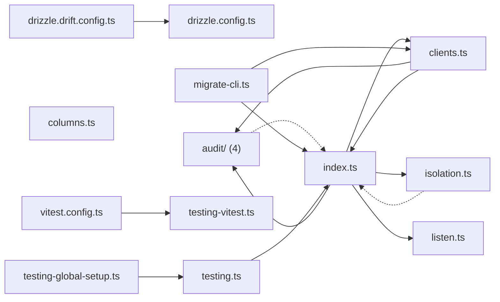

# @wren/db

Role: package. Files: 16.

## Uses

- @wren/config

## Outside packages

@testcontainers/postgresql@12.1.0, drizzle-kit@0.31.10, drizzle-orm@0.45.2, node:async_hooks, node:crypto, node:fs, node:os, node:path, node:url, postgres@3.4.9, vitest@5.0.1

## Folders

Dotted: types only.

## Files

- audit/: src/audit/acting.ts, src/audit/index.ts, src/audit/install.ts, src/audit/schema.ts
- clients.ts
- columns.ts
- drizzle.config.ts
- drizzle.drift.config.ts
- index.ts
- isolation.ts
- listen.ts
- migrate-cli.ts
- testing-global-setup.ts
- testing-vitest.ts
- testing.ts
- vitest.config.ts
