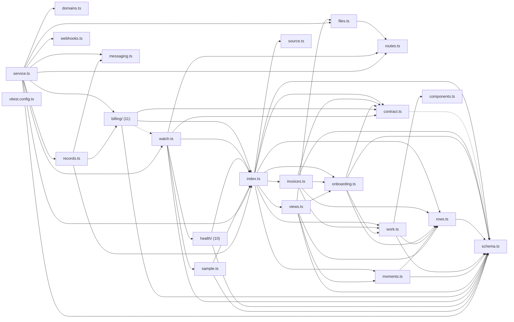

# @wren/delivery

Role: package. Files: 42.

## Uses

- @wren/core
- @wren/offers
- @wren/db
- @wren/pipeline
- @wren/books
- @wren/documents

## Outside packages

node:crypto, node:fs

## Folders

Dotted: types only.

## Files

- billing/: src/billing/console-routes.ts, src/billing/console.ts, src/billing/credits.ts, src/billing/index.ts, src/billing/mail.ts, src/billing/match.ts, src/billing/receive.ts, src/billing/records.ts, src/billing/tell.ts, src/billing/watch.ts, src/billing/wise.ts
- components.ts
- contract.ts
- domains.ts
- files.ts
- health/: src/health/console-routes.ts, src/health/console.ts, src/health/flags.ts, src/health/hand.ts, src/health/index.ts, src/health/pass.ts, src/health/records.ts, src/health/schema.ts, src/health/score.ts, src/health/views.ts
- index.ts
- invoices.ts
- messaging.ts
- moments.ts
- onboarding.ts
- records.ts
- routes.ts
- rows.ts
- sample.ts
- schema.ts
- service.ts
- source.ts
- views.ts
- vitest.config.ts
- watch.ts
- webhooks.ts
- work.ts
