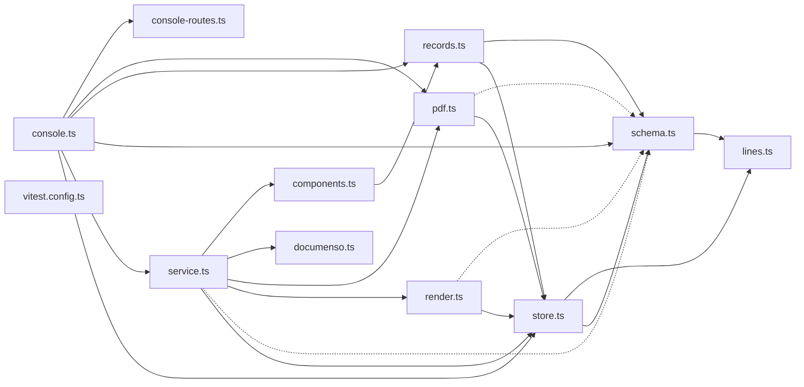

# @wren/documents

Role: package. Files: 12.

## Uses

- @wren/core
- @wren/db
- @wren/payments
- @wren/channel-sms

## Outside packages

node:crypto

## Folders

Dotted: types only.

## Files

- components.ts
- console-routes.ts
- console.ts
- documenso.ts
- lines.ts
- pdf.ts
- records.ts
- render.ts
- schema.ts
- service.ts
- store.ts
- vitest.config.ts
