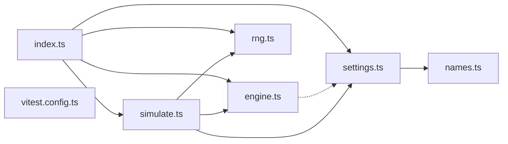

# @wren/experiments

Role: package. Files: 7.

## Outside packages

node:crypto

## Folders

Dotted: types only.

## Files

- engine.ts
- index.ts
- names.ts
- rng.ts
- settings.ts
- simulate.ts
- vitest.config.ts
