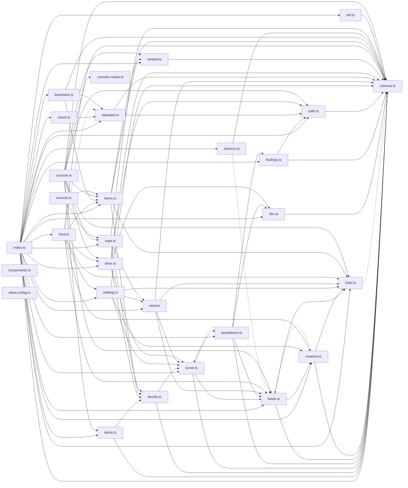

# @wren/learn

Role: package. Files: 29.

## Uses

- @wren/core
- @wren/db
- @wren/research
- @wren/llm
- @wren/notes

## Outside packages

node:fs, node:path

## Folders

Dotted: types only.

## Files

- alerts.ts
- breakdown.ts
- calls.ts
- catalog.ts
- check.ts
- components.ts
- console-routes.ts
- console.ts
- creators.ts
- decide.ts
- drive.ts
- embed.ts
- feeds.ts
- film.ts
- findings.ts
- hunt.ts
- index.ts
- items.ts
- learnback.ts
- links.ts
- pictures.ts
- read.ts
- records.ts
- schema.ts
- score.ts
- sops.ts
- standard.ts
- tell.ts
- vitest.config.ts
