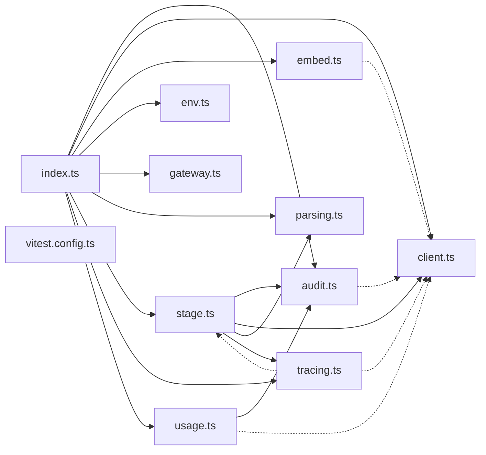

# @wren/llm

Role: package. Files: 11.

## Outside packages

@wrenautomation/models@0.8.2, node:fs, node:path, vitest@5.0.1, zod@4.6.5

## Folders

Dotted: types only.

## Files

- audit.ts
- client.ts
- embed.ts
- env.ts
- gateway.ts
- index.ts
- parsing.ts
- stage.ts
- tracing.ts
- usage.ts
- vitest.config.ts
