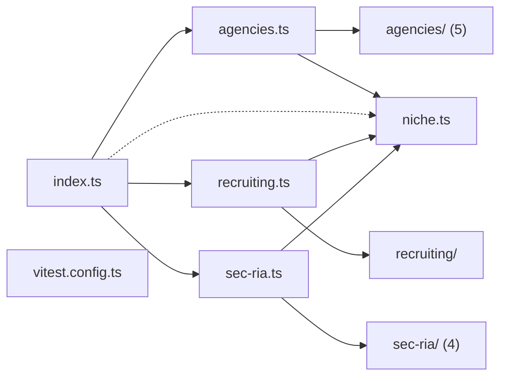

# @wren/niches

Role: package. Files: 16.

## Uses

- @wren/channel-email
- @wren/channel-sms
- @wren/core
- @wren/db
- @wren/offers
- @wren/research

## Outside packages

node:crypto, node:fs, node:path, node:zlib

## Folders

Dotted: types only.

## Files

- agencies.ts
- agencies/: src/agencies/clutch-pages.ts, src/agencies/directory.ts, src/agencies/facts.ts, src/agencies/profiles.ts, src/agencies/shopify-pages.ts
- index.ts
- niche.ts
- recruiting.ts
- recruiting/: src/recruiting/sources.ts
- sec-ria.ts
- sec-ria/: src/sec-ria/datasets.ts, src/sec-ria/filing-data.ts, src/sec-ria/firm-feed.ts, src/sec-ria/roster.ts
- vitest.config.ts
