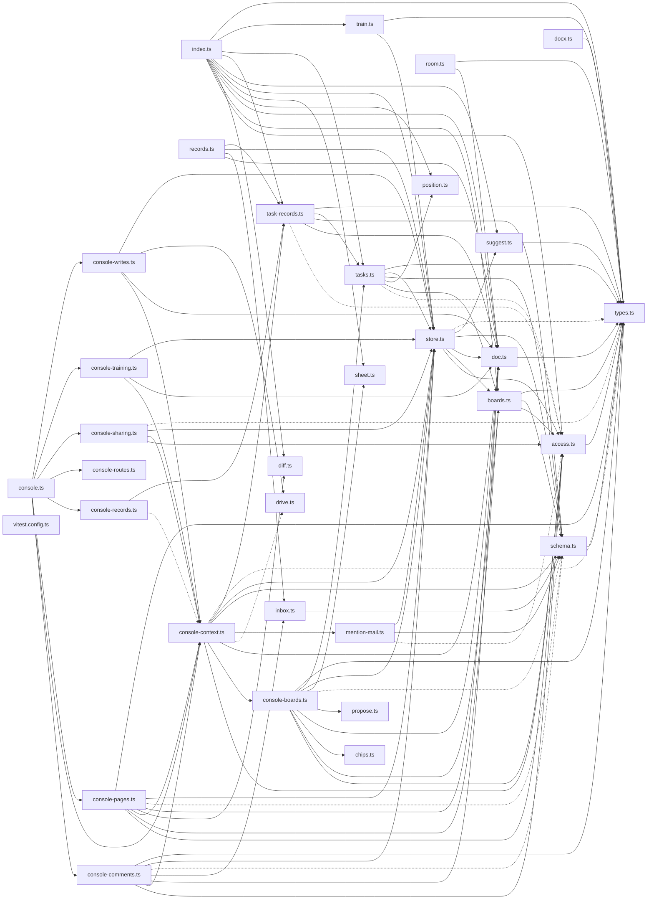

# @wren/notes

Role: package. Files: 33.

## Uses

- @wren/core
- @wren/db

## Folders

Dotted: types only.

## Files

- access.ts
- boards.ts
- chips.ts
- console-boards.ts
- console-comments.ts
- console-context.ts
- console-pages.ts
- console-records.ts
- console-routes.ts
- console-sharing.ts
- console-training.ts
- console-writes.ts
- console.ts
- diff.ts
- doc.ts
- docx.ts
- drive.ts
- inbox.ts
- index.ts
- mention-mail.ts
- position.ts
- propose.ts
- records.ts
- room.ts
- schema.ts
- sheet.ts
- store.ts
- suggest.ts
- task-records.ts
- tasks.ts
- train.ts
- types.ts
- vitest.config.ts
