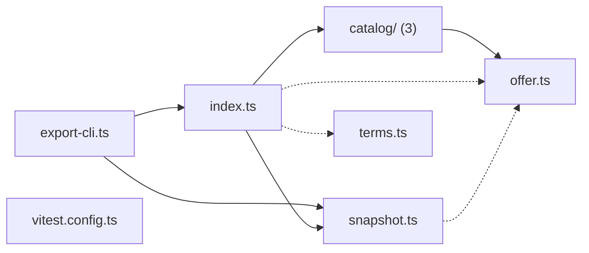

# @wren/offers

Role: package. Files: 9.

## Outside packages

node:fs, node:path, vitest@5.0.1

## Folders

Dotted: types only.

## Files

- catalog/: src/catalog/growth-partner.ts, src/catalog/operations.ts, src/catalog/recruiting.ts
- export-cli.ts
- index.ts
- offer.ts
- snapshot.ts
- terms.ts
- vitest.config.ts
