# @wren/outreach

Role: package. Files: 68.

## Uses

- @wren/channel-reddit
- @wren/core
- @wren/db
- @wren/llm
- @wren/config (types only)
- @wren/channel-linkedin
- @wren/research

## Outside packages

node:crypto

## Folders

Dotted: types only.

```mermaid
flowchart LR
  nindex_ts["index.ts"]
  naccounts_ts["accounts.ts"]
  npolicy_ts["policy.ts"]
  nschema_ts["schema.ts"]
  nrefusal_ts["refusal.ts"]
  nclients_ts["clients.ts"]
  ncomments_ts["comments.ts"]
  ncontacts_ts["contacts.ts"]
  nsequences_ts["sequences.ts"]
  ndiscovery_["discovery/ (5)"]
  ndraft_accounts_ts["draft-accounts.ts"]
  ndraft_llm_ts["draft-llm.ts"]
  nexamples_ts["examples.ts"]
  npacing_ts["pacing.ts"]
  npasses_ts["passes.ts"]
  nreach_posts_ts["reach-posts.ts"]
  ntouches_ts["touches.ts"]
  ntick_ts["tick.ts"]
  nsend_attempts_ts["send-attempts.ts"]
  nstore_ts["store.ts"]
  ndraft_models_ts["draft-models.ts"]
  ndrafts_ts["drafts.ts"]
  ninvites_ts["invites.ts"]
  nenroll_ts["enroll.ts"]
  nfollow_ups_ts["follow-ups.ts"]
  nfollow_ts["follow.ts"]
  nproofs_ts["proofs.ts"]
  nreplies_ts["replies.ts"]
  nreply_drafts_ts["reply-drafts.ts"]
  nsettings_ts["settings.ts"]
  nsettle_send_ts["settle-send.ts"]
  nthreads_ts["threads.ts"]
  nrecords_ts["records.ts"]
  nfrom_people_ts["from-people.ts"]
  ncomponents_ts["components.ts"]
  nrestate_["restate/ (21)"]
  ninvite_notes_ts["invite-notes.ts"]
  nlimits_ts["limits.ts"]
  nscheduled_ts["scheduled.ts"]
  ncreator_search_ts["creator-search.ts"]
  nintercept_ts["intercept.ts"]
  ndecide_ts["decide.ts"]
  npain_ts["pain.ts"]
  nvitest_config_ts["vitest.config.ts"]
  nindex_ts --> naccounts_ts
  nindex_ts --> nclients_ts
  nindex_ts --> ncomments_ts
  nindex_ts --> ncontacts_ts
  nindex_ts --> ndiscovery_
  nindex_ts --> ndraft_accounts_ts
  nindex_ts --> ndraft_llm_ts
  nindex_ts --> ndraft_models_ts
  nindex_ts --> ndrafts_ts
  nindex_ts --> nenroll_ts
  nindex_ts --> nexamples_ts
  nindex_ts --> nfollow_ups_ts
  nindex_ts --> nfollow_ts
  nindex_ts --> ninvites_ts
  nindex_ts --> npasses_ts
  nindex_ts --> npolicy_ts
  nindex_ts --> nproofs_ts
  nindex_ts --> nreach_posts_ts
  nindex_ts --> nrefusal_ts
  nindex_ts --> nreplies_ts
  nindex_ts --> nreply_drafts_ts
  nindex_ts --> nschema_ts
  nindex_ts --> nsend_attempts_ts
  nindex_ts --> nsequences_ts
  nindex_ts --> nsettings_ts
  nindex_ts --> nsettle_send_ts
  nindex_ts --> nstore_ts
  nindex_ts --> nthreads_ts
  nindex_ts --> ntick_ts
  naccounts_ts --> npolicy_ts
  naccounts_ts --> nrefusal_ts
  naccounts_ts --> nschema_ts
  npolicy_ts -.-> nschema_ts
  nclients_ts --> naccounts_ts
  nclients_ts --> nschema_ts
  ncomments_ts --> ncontacts_ts
  ncomments_ts --> ndiscovery_
  ncomments_ts --> ndraft_accounts_ts
  ncomments_ts --> ndraft_llm_ts
  ncomments_ts --> nexamples_ts
  ncomments_ts --> npasses_ts
  ncomments_ts --> nrefusal_ts
  ncomments_ts --> nschema_ts
  ncomments_ts --> ntick_ts
  ncomments_ts --> ntouches_ts
  ncontacts_ts --> nrefusal_ts
  ncontacts_ts --> nschema_ts
  ncontacts_ts --> nsequences_ts
  nsequences_ts -.-> nschema_ts
  ndiscovery_ --> ndraft_accounts_ts
  ndiscovery_ --> ndraft_llm_ts
  ndiscovery_ --> nexamples_ts
  ndiscovery_ --> npacing_ts
  ndiscovery_ --> npasses_ts
  ndiscovery_ --> nrefusal_ts
  ndiscovery_ --> nschema_ts
  ndiscovery_ --> ntouches_ts
  ndraft_accounts_ts --> naccounts_ts
  ndraft_accounts_ts --> ndiscovery_
  ndraft_accounts_ts --> nrefusal_ts
  ndraft_accounts_ts --> nschema_ts
  nexamples_ts --> nschema_ts
  npasses_ts --> ncomments_ts
  npasses_ts --> ndiscovery_
  npasses_ts --> nreach_posts_ts
  npasses_ts --> nschema_ts
  nreach_posts_ts --> ndraft_llm_ts
  nreach_posts_ts --> nexamples_ts
  nreach_posts_ts --> npasses_ts
  nreach_posts_ts --> nrefusal_ts
  nreach_posts_ts --> nschema_ts
  nreach_posts_ts --> ntouches_ts
  ntouches_ts --> ndraft_accounts_ts
  ntouches_ts --> nschema_ts
  ntick_ts --> naccounts_ts
  ntick_ts --> ncontacts_ts
  ntick_ts --> npolicy_ts
  ntick_ts --> nrefusal_ts
  ntick_ts --> nschema_ts
  ntick_ts --> nsend_attempts_ts
  ntick_ts --> nsequences_ts
  ntick_ts --> nstore_ts
  ntick_ts --> ntouches_ts
  nsend_attempts_ts --> nrefusal_ts
  nsend_attempts_ts --> nschema_ts
  nstore_ts --> nrefusal_ts
  nstore_ts --> nsequences_ts
  ndrafts_ts --> ncontacts_ts
  ndrafts_ts --> ndiscovery_
  ndrafts_ts --> ndraft_accounts_ts
  ndrafts_ts --> ndraft_llm_ts
  ndrafts_ts --> ninvites_ts
  ndrafts_ts --> nrefusal_ts
  ndrafts_ts --> nschema_ts
  ndrafts_ts --> ntick_ts
  ninvites_ts --> naccounts_ts
  ninvites_ts --> ncontacts_ts
  ninvites_ts --> nenroll_ts
  ninvites_ts --> npolicy_ts
  ninvites_ts --> nschema_ts
  ninvites_ts --> nsend_attempts_ts
  ninvites_ts -.-> nsequences_ts
  ninvites_ts -.-> ntick_ts
  ninvites_ts --> ntouches_ts
  nenroll_ts --> naccounts_ts
  nenroll_ts --> ncontacts_ts
  nenroll_ts --> nrefusal_ts
  nenroll_ts --> nschema_ts
  nenroll_ts --> nsequences_ts
  nenroll_ts --> nstore_ts
  nfollow_ups_ts --> ncomments_ts
  nfollow_ups_ts --> nrefusal_ts
  nfollow_ups_ts --> nschema_ts
  nfollow_ups_ts --> ntouches_ts
  nfollow_ts --> ncontacts_ts
  nfollow_ts --> nschema_ts
  nfollow_ts --> nsequences_ts
  nfollow_ts --> nstore_ts
  nfollow_ts --> ntick_ts
  nproofs_ts --> ndiscovery_
  nproofs_ts --> nschema_ts
  nreplies_ts --> ncontacts_ts
  nreplies_ts --> nschema_ts
  nreplies_ts --> ntouches_ts
  nreply_drafts_ts --> nschema_ts
  nsettings_ts --> npolicy_ts
  nsettle_send_ts --> ncomments_ts
  nsettle_send_ts --> ncontacts_ts
  nsettle_send_ts --> ndiscovery_
  nsettle_send_ts --> nreach_posts_ts
  nsettle_send_ts --> nrefusal_ts
  nsettle_send_ts --> nschema_ts
  nsettle_send_ts --> nsend_attempts_ts
  nsettle_send_ts --> ntick_ts
  nthreads_ts --> ncontacts_ts
  nthreads_ts --> nschema_ts
  nrecords_ts --> naccounts_ts
  nrecords_ts --> ndiscovery_
  nrecords_ts --> ndraft_accounts_ts
  nrecords_ts --> nfollow_ups_ts
  nrecords_ts --> nfrom_people_ts
  nrecords_ts --> ninvites_ts
  nrecords_ts --> npolicy_ts
  nrecords_ts --> nschema_ts
  nrecords_ts --> nsequences_ts
  nrecords_ts --> nstore_ts
  nrecords_ts --> nthreads_ts
  nrecords_ts --> ntick_ts
  nfrom_people_ts --> naccounts_ts
  nfrom_people_ts --> ncomments_ts
  nfrom_people_ts --> ncontacts_ts
  nfrom_people_ts --> npasses_ts
  nfrom_people_ts --> nrefusal_ts
  nfrom_people_ts --> nschema_ts
  nfrom_people_ts --> ntouches_ts
  ncomponents_ts --> ndiscovery_
  ncomponents_ts --> nfollow_ups_ts
  ncomponents_ts --> ninvites_ts
  ncomponents_ts --> nreach_posts_ts
  nrestate_ --> nschema_ts
  nrestate_ --> nclients_ts
  nrestate_ --> ndrafts_ts
  nrestate_ -.-> npolicy_ts
  nrestate_ --> nsequences_ts
  nrestate_ --> naccounts_ts
  nrestate_ --> ncomments_ts
  nrestate_ --> ncontacts_ts
  nrestate_ --> nenroll_ts
  nrestate_ --> ninvites_ts
  nrestate_ --> nrefusal_ts
  nrestate_ --> nsend_attempts_ts
  nrestate_ --> nproofs_ts
  nrestate_ --> nfollow_ups_ts
  nrestate_ --> ninvite_notes_ts
  nrestate_ --> nlimits_ts
  nrestate_ --> nreach_posts_ts
  nrestate_ --> nreplies_ts
  nrestate_ --> nscheduled_ts
  ninvite_notes_ts --> ndraft_llm_ts
  ninvite_notes_ts --> ndrafts_ts
  ninvite_notes_ts --> nrefusal_ts
  ninvite_notes_ts --> nschema_ts
  ninvite_notes_ts --> ntick_ts
  nlimits_ts -.-> nschema_ts
  nscheduled_ts --> ndiscovery_
  nscheduled_ts --> npacing_ts
  nscheduled_ts -.-> nreach_posts_ts
  nscheduled_ts --> nschema_ts
  nscheduled_ts --> nsend_attempts_ts
  nrestate_ --> ndraft_accounts_ts
  nrestate_ --> nstore_ts
  nrestate_ --> nfrom_people_ts
  nrestate_ --> npasses_ts
  nrestate_ --> nfollow_ts
  nrestate_ --> nsettle_send_ts
  nrestate_ --> ndraft_models_ts
  nrestate_ --> nthreads_ts
  nrestate_ --> ndiscovery_
  nrestate_ --> ncreator_search_ts
  nrestate_ --> nintercept_ts
  ncreator_search_ts --> ndiscovery_
  nintercept_ts --> ndiscovery_
  nintercept_ts --> nreach_posts_ts
  nintercept_ts --> nrefusal_ts
  nintercept_ts --> nschema_ts
  nrestate_ --> ntick_ts
  npain_ts --> npasses_ts
  npain_ts --> nreach_posts_ts
  npain_ts --> nschema_ts
```

## Files

- accounts.ts
- clients.ts
- comments.ts
- components.ts
- contacts.ts
- creator-search.ts
- decide.ts
- discovery/: src/discovery/people.ts, src/discovery/places.ts, src/discovery/reads.ts, src/discovery/requirements.ts, src/discovery/threads.ts
- draft-accounts.ts
- draft-llm.ts
- draft-models.ts
- drafts.ts
- enroll.ts
- examples.ts
- follow-ups.ts
- follow.ts
- from-people.ts
- index.ts
- intercept.ts
- invite-notes.ts
- invites.ts
- limits.ts
- pacing.ts
- pain.ts
- passes.ts
- policy.ts
- proofs.ts
- reach-posts.ts
- records.ts
- refusal.ts
- replies.ts
- reply-drafts.ts
- restate/: src/restate/deps.ts, src/restate/desk-accounts.ts, src/restate/desk-comments.ts, src/restate/desk-contacts.ts, src/restate/desk-context.ts, src/restate/desk-invites.ts, src/restate/desk-people.ts, src/restate/desk-posts.ts, src/restate/desk-schedule.ts, src/restate/desk-settle.ts, src/restate/desk-stats.ts, src/restate/desk-threads.ts, src/restate/desk.ts, src/restate/discovery.ts, src/restate/index.ts, src/restate/maybe-sent.ts, src/restate/paste.ts, src/restate/proofs.ts, src/restate/schedule.ts, src/restate/sender.ts, src/restate/watch.ts
- scheduled.ts
- schema.ts
- send-attempts.ts
- sequences.ts
- settings.ts
- settle-send.ts
- store.ts
- threads.ts
- tick.ts
- touches.ts
- vitest.config.ts
