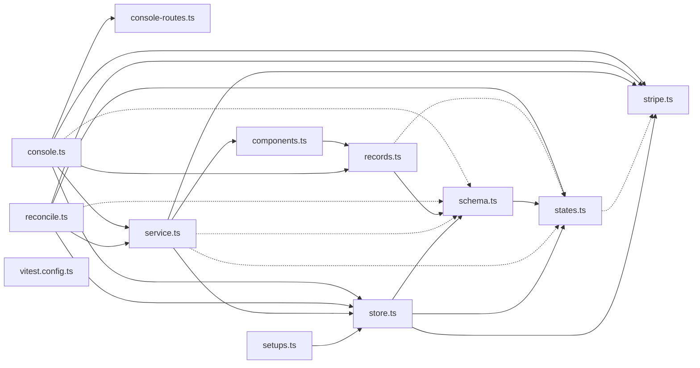

# @wren/payments

Role: package. Files: 12.

## Uses

- @wren/channel-sms
- @wren/core
- @wren/db

## Outside packages

@restatedev/restate-sdk@1.17.1, drizzle-orm@0.45.2, node:crypto, stripe@22.6.2, zod@4.6.5

## Folders

Dotted: types only.

## Files

- components.ts
- console-routes.ts
- console.ts
- reconcile.ts
- records.ts
- schema.ts
- service.ts
- setups.ts
- states.ts
- store.ts
- stripe.ts
- vitest.config.ts
