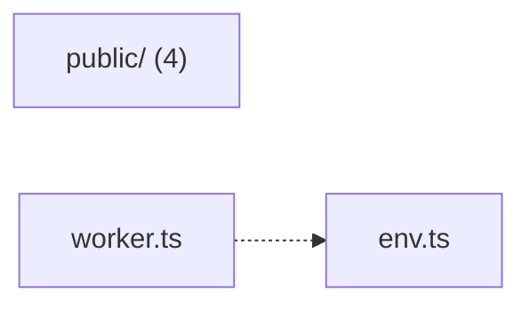

# @wren/phone

Role: package. Files: 6.

## Uses

- @wren/auth
- @wren/channel-sms
- @wren/core

## Folders

Dotted: types only.

## Files

- env.ts
- public/: public/app.js, public/c.js, public/sw.js, public/u.js
- worker.ts
