# @wren/pipeline

Role: package. Files: 51.

## Uses

- @wren/core
- @wren/db
- @wren/offers
- @wren/research

## Outside packages

node:crypto, node:fs

## Folders

Dotted: types only.

```mermaid
flowchart LR
  nattach_ts["attach.ts"]
  nattribution_ts["attribution.ts"]
  nblame_ts["blame.ts"]
  ncarry_ts["carry.ts"]
  nchain_methods_ts["chain-methods.ts"]
  nchain_ts["chain.ts"]
  ncollect_ts["collect.ts"]
  ncomponents_ts["components.ts"]
  nconsole_routes_ts["console-routes.ts"]
  nconsole_ts["console.ts"]
  nconvert_shape_ts["convert-shape.ts"]
  nconvert_ts["convert.ts"]
  ndiff_ts["diff.ts"]
  ndrafts_ts["drafts.ts"]
  nedit_ts["edit.ts"]
  nentry_ts["entry.ts"]
  nhistory_ts["history.ts"]
  nicp_ts["icp.ts"]
  njourneys_ts["journeys.ts"]
  nlines_ts["lines.ts"]
  nmap_read_ts["map-read.ts"]
  nmetro_blame_ts["metro-blame.ts"]
  nmetro_diff_ts["metro-diff.ts"]
  nmetro_edit_ts["metro-edit.ts"]
  nmetro_file_ts["metro-file.ts"]
  nmetro_merge_ts["metro-merge.ts"]
  nmetro_ops_ts["metro-ops.ts"]
  nmetro_parts_ts["metro-parts.ts"]
  nmetro_ts["metro.ts"]
  nmirror_ts["mirror.ts"]
  nmodel_ts["model.ts"]
  nmoves_ts["moves.ts"]
  nnumbers_ts["numbers.ts"]
  nrecords_ts["records.ts"]
  nrefused_ts["refused.ts"]
  nresearch_ts["research.ts"]
  nrestate_ts["restate.ts"]
  nschedule_ts["schedule.ts"]
  nschema_ts["schema.ts"]
  nshape_file_ts["shape-file.ts"]
  nsourced_ts["sourced.ts"]
  nstarter_ts["starter.ts"]
  nsteps_ts["steps.ts"]
  nstore_ts["store.ts"]
  nstored_ts["stored.ts"]
  ntags_ts["tags.ts"]
  nundo_ts["undo.ts"]
  nviews_ts["views.ts"]
  nworkflow_ts["workflow.ts"]
  ntest_["test/"]
  nvitest_config_ts["vitest.config.ts"]
  nattach_ts --> nmetro_ops_ts
  nattach_ts -.-> nmetro_ts
  nattach_ts -.-> nschema_ts
  nattach_ts --> nstore_ts
  nattach_ts --> nstored_ts
  nattribution_ts -.-> nentry_ts
  nblame_ts --> ndiff_ts
  nblame_ts -.-> nhistory_ts
  nblame_ts -.-> nmodel_ts
  ncarry_ts -.-> nmodel_ts
  ncarry_ts --> nschema_ts
  ncarry_ts --> nstored_ts
  ncarry_ts --> nworkflow_ts
  nchain_methods_ts --> nchain_ts
  nchain_methods_ts --> nmodel_ts
  nchain_ts --> nmodel_ts
  ncollect_ts --> njourneys_ts
  ncollect_ts --> nschema_ts
  ncomponents_ts --> nrecords_ts
  nconsole_ts --> nattach_ts
  nconsole_ts --> nconsole_routes_ts
  nconsole_ts --> ndrafts_ts
  nconsole_ts -.-> nhistory_ts
  nconsole_ts --> nmap_read_ts
  nconsole_ts --> nmetro_ops_ts
  nconsole_ts --> nmetro_ts
  nconsole_ts --> nmirror_ts
  nconsole_ts -.-> nmodel_ts
  nconsole_ts --> nmoves_ts
  nconsole_ts --> nrecords_ts
  nconsole_ts --> nrestate_ts
  nconsole_ts --> nshape_file_ts
  nconsole_ts --> nstarter_ts
  nconsole_ts --> nstore_ts
  nconsole_ts --> nstored_ts
  nconsole_ts --> ntags_ts
  nconsole_ts --> nundo_ts
  nconvert_shape_ts --> nconvert_ts
  nconvert_shape_ts --> ndiff_ts
  nconvert_shape_ts --> nmetro_ts
  nconvert_shape_ts -.-> nmodel_ts
  nconvert_shape_ts --> nnumbers_ts
  nconvert_shape_ts --> nrefused_ts
  nconvert_shape_ts -.-> nschema_ts
  nconvert_shape_ts --> nstore_ts
  nconvert_shape_ts --> nstored_ts
  nconvert_shape_ts --> nworkflow_ts
  nconvert_ts --> nmetro_ts
  nconvert_ts --> nmodel_ts
  ndiff_ts -.-> nmodel_ts
  ndrafts_ts -.-> ncarry_ts
  ndrafts_ts --> nhistory_ts
  ndrafts_ts --> nmetro_merge_ts
  ndrafts_ts --> nmetro_ops_ts
  ndrafts_ts --> nmetro_ts
  ndrafts_ts --> nschema_ts
  ndrafts_ts --> nstore_ts
  ndrafts_ts --> nstored_ts
  nedit_ts -.-> ncarry_ts
  nedit_ts --> ndiff_ts
  nedit_ts -.-> nmetro_diff_ts
  nedit_ts --> nmetro_edit_ts
  nedit_ts --> nmetro_ts
  nedit_ts --> nmodel_ts
  nedit_ts --> nschema_ts
  nedit_ts --> nstore_ts
  nedit_ts --> nstored_ts
  nentry_ts -.-> nmodel_ts
  nhistory_ts -.-> ncarry_ts
  nhistory_ts -.-> nmetro_diff_ts
  nhistory_ts -.-> nmetro_ts
  nhistory_ts -.-> nmodel_ts
  nhistory_ts -.-> nstored_ts
  njourneys_ts --> nmodel_ts
  njourneys_ts --> nschema_ts
  njourneys_ts --> nstored_ts
  njourneys_ts --> nworkflow_ts
  nlines_ts --> nentry_ts
  nlines_ts --> njourneys_ts
  nlines_ts --> nmodel_ts
  nlines_ts --> nschema_ts
  nlines_ts --> nstored_ts
  nlines_ts --> nworkflow_ts
  nmap_read_ts -.-> nhistory_ts
  nmap_read_ts -.-> nmetro_ts
  nmap_read_ts -.-> nmodel_ts
  nmap_read_ts --> nnumbers_ts
  nmap_read_ts --> nrecords_ts
  nmetro_blame_ts --> nblame_ts
  nmetro_blame_ts -.-> nhistory_ts
  nmetro_blame_ts --> nmetro_diff_ts
  nmetro_blame_ts -.-> nmetro_ts
  nmetro_diff_ts --> ndiff_ts
  nmetro_diff_ts -.-> nmetro_ts
  nmetro_edit_ts --> ndiff_ts
  nmetro_edit_ts --> nmetro_diff_ts
  nmetro_edit_ts -.-> nmetro_ts
  nmetro_edit_ts --> nrefused_ts
  nmetro_file_ts -.-> nmetro_ts
  nmetro_file_ts --> nrefused_ts
  nmetro_merge_ts --> ndiff_ts
  nmetro_merge_ts --> nmetro_diff_ts
  nmetro_merge_ts -.-> nmetro_ts
  nmetro_ops_ts --> nconvert_ts
  nmetro_ops_ts --> nmetro_diff_ts
  nmetro_ops_ts --> nmetro_edit_ts
  nmetro_ops_ts --> nmetro_file_ts
  nmetro_ops_ts --> nmetro_ts
  nmetro_ops_ts --> nmodel_ts
  nmetro_ops_ts --> nrefused_ts
  nmetro_ops_ts --> nstored_ts
  nmetro_parts_ts -.-> nmetro_ts
  nmetro_ts --> nmodel_ts
  nmirror_ts --> nschema_ts
  nmirror_ts --> nshape_file_ts
  nmirror_ts --> nstore_ts
  nmoves_ts --> nentry_ts
  nmoves_ts --> njourneys_ts
  nmoves_ts --> nmodel_ts
  nmoves_ts --> nschema_ts
  nmoves_ts --> nstore_ts
  nmoves_ts --> nstored_ts
  nmoves_ts --> nworkflow_ts
  nnumbers_ts --> nchain_methods_ts
  nnumbers_ts --> nchain_ts
  nnumbers_ts --> nmetro_ts
  nnumbers_ts --> nmodel_ts
  nnumbers_ts --> nschedule_ts
  nnumbers_ts --> nschema_ts
  nnumbers_ts --> nstore_ts
  nnumbers_ts --> nstored_ts
  nnumbers_ts --> nviews_ts
  nrecords_ts -.-> nhistory_ts
  nrecords_ts -.-> nicp_ts
  nrecords_ts --> nmetro_ts
  nrecords_ts -.-> nmodel_ts
  nrecords_ts --> nmoves_ts
  nrecords_ts --> nnumbers_ts
  nrecords_ts --> nschedule_ts
  nrecords_ts --> nschema_ts
  nrecords_ts --> nstored_ts
  nresearch_ts -.-> nicp_ts
  nresearch_ts --> nschema_ts
  nrestate_ts --> njourneys_ts
  nrestate_ts --> nmoves_ts
  nrestate_ts --> nschema_ts
  nrestate_ts --> nstore_ts
  nschema_ts -.-> ncarry_ts
  nschema_ts --> nhistory_ts
  nschema_ts --> nmodel_ts
  nschema_ts -.-> nstored_ts
  nshape_file_ts -.-> ncarry_ts
  nshape_file_ts --> nmetro_file_ts
  nshape_file_ts --> nmetro_ts
  nshape_file_ts -.-> nschema_ts
  nshape_file_ts --> nstore_ts
  nshape_file_ts --> nstored_ts
  nsourced_ts --> nentry_ts
  nsourced_ts --> nschema_ts
  nsourced_ts --> nstored_ts
  nstarter_ts -.-> nschema_ts
  nstarter_ts --> nshape_file_ts
  nstarter_ts --> nstore_ts
  nsteps_ts --> nattribution_ts
  nsteps_ts --> nentry_ts
  nsteps_ts --> njourneys_ts
  nsteps_ts --> nmodel_ts
  nsteps_ts --> nmoves_ts
  nsteps_ts --> nresearch_ts
  nsteps_ts --> nschema_ts
  nsteps_ts --> nstore_ts
  nsteps_ts --> nworkflow_ts
  nstore_ts --> ncarry_ts
  nstore_ts --> ndiff_ts
  nstore_ts --> nmetro_ts
  nstore_ts --> nmodel_ts
  nstore_ts --> nrefused_ts
  nstore_ts --> nschema_ts
  nstore_ts --> nstored_ts
  nstored_ts --> nblame_ts
  nstored_ts --> nconvert_ts
  nstored_ts --> ndiff_ts
  nstored_ts -.-> nhistory_ts
  nstored_ts --> nmetro_blame_ts
  nstored_ts --> nmetro_diff_ts
  nstored_ts --> nmetro_ts
  nstored_ts --> nmodel_ts
  nstored_ts --> nrefused_ts
  ntags_ts --> nschema_ts
  ntags_ts --> nstore_ts
  nundo_ts --> nedit_ts
  nundo_ts -.-> nschema_ts
  nundo_ts --> nstore_ts
  nundo_ts --> nstored_ts
  nviews_ts --> nschema_ts
  nworkflow_ts --> nmodel_ts
  ntest_ --> nconvert_ts
  ntest_ -.-> nmetro_ts
  ntest_ --> nmodel_ts
  ntest_ --> nschema_ts
  ntest_ --> nstarter_ts
  ntest_ --> nstore_ts
```

## Files

- attach.ts
- attribution.ts
- blame.ts
- carry.ts
- chain-methods.ts
- chain.ts
- collect.ts
- components.ts
- console-routes.ts
- console.ts
- convert-shape.ts
- convert.ts
- diff.ts
- drafts.ts
- edit.ts
- entry.ts
- history.ts
- icp.ts
- journeys.ts
- lines.ts
- map-read.ts
- metro-blame.ts
- metro-diff.ts
- metro-edit.ts
- metro-file.ts
- metro-merge.ts
- metro-ops.ts
- metro-parts.ts
- metro.ts
- mirror.ts
- model.ts
- moves.ts
- numbers.ts
- records.ts
- refused.ts
- research.ts
- restate.ts
- schedule.ts
- schema.ts
- shape-file.ts
- sourced.ts
- starter.ts
- steps.ts
- store.ts
- stored.ts
- tags.ts
- test/: test/fixtures.ts
- undo.ts
- views.ts
- vitest.config.ts
- workflow.ts
