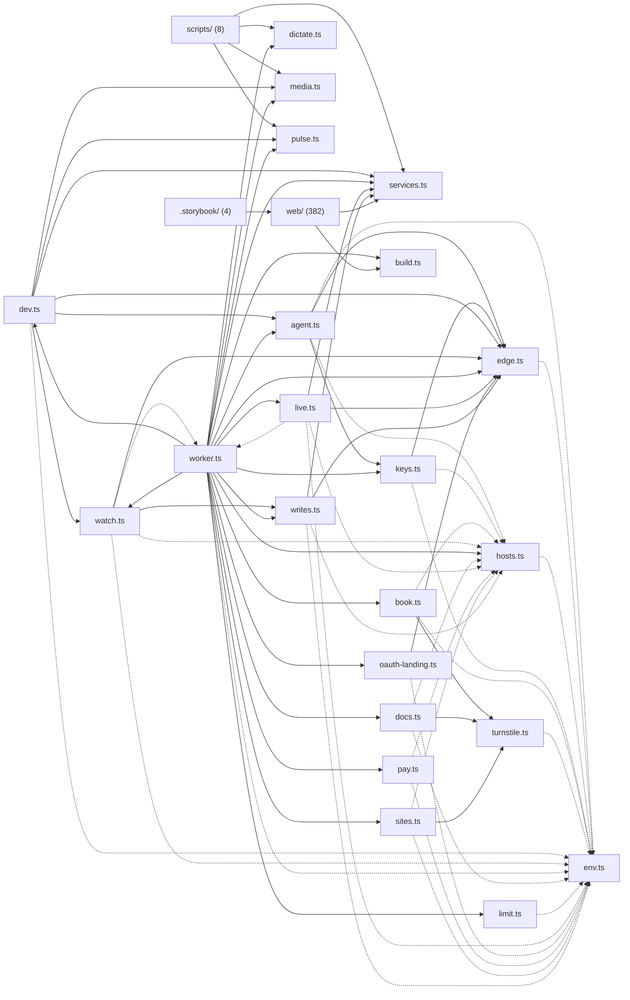

# @wren/portal

Role: package. Files: 416.

## Uses

- @wren/ui
- @wren/pipeline
- @wren/books
- @wren/calendar
- @wren/channel-email
- @wren/channel-sms
- @wren/connectors
- @wren/content
- @wren/core
- @wren/delivery
- @wren/documents
- @wren/learn
- @wren/notes
- @wren/payments
- @wren/reactivation
- @wren/sites
- @wren/voice
- @wren/watch
- @wren/worker
- @wren/config
- @wren/db
- @wren/llm
- @wren/outreach
- @wren/studio
- @wren/auth
- @wren/offers

## Outside packages

node:assert, node:crypto, node:fs, node:http, node:module, node:os, node:path, node:url, node:zlib, virtual:record-types

## Folders

Dotted: types only.

## Files

- .storybook/: .storybook/main.ts, .storybook/preview.tsx, .storybook/public/mockServiceWorker.js, .storybook/vitest.config.ts
- agent.ts
- book.ts
- build.ts
- dev.ts
- dictate.ts
- docs.ts
- edge.ts
- env.ts
- hosts.ts
- keys.ts
- limit.ts
- live.ts
- media.ts
- oauth-landing.ts
- pay.ts
- pulse.ts
- scripts/: scripts/contrast.ts, scripts/e2e-kit.ts, scripts/libs-e2e.ts, scripts/outreach-e2e.ts, scripts/preview.ts, scripts/threads-e2e.ts, scripts/writes-e2e.ts, scripts/ws.d.ts
- services.ts
- sites.ts
- turnstile.ts
- watch.ts
- web/: web/node-stubs.ts, web/public/agent/wren.mjs, web/public/dictate-mic.js, web/public/look.js, web/src/App.tsx, web/src/access.ts, web/src/api.ts, web/src/app.css, web/src/apps-context.ts, web/src/areas.ts, web/src/autotrack.ts, web/src/book-path.ts, web/src/book.tsx, web/src/contained.tsx, web/src/dev-banner.tsx, web/src/dictation/engine.ts, web/src/dictation/index.ts, web/src/dictation/kept.ts, web/src/dictation/mic.ts, web/src/dictation/model.ts, web/src/dictation/model.worker.ts, web/src/dictation/protocol.ts, web/src/dictation/server.ts, web/src/dictation/speech.ts, web/src/find.ts, web/src/flags.tsx, web/src/kanban.tsx, web/src/keys.ts, web/src/lanes.ts, web/src/load.ts, web/src/local.ts, web/src/look-pref.ts, web/src/main.tsx, web/src/map/BlameList.tsx, web/src/map/DraftBanner.tsx, web/src/map/DraftList.tsx, web/src/map/FocusPage.tsx, web/src/map/History.tsx, web/src/map/Home.tsx, web/src/map/Import.tsx, web/src/map/MapPage.tsx, web/src/map/NodePanel.tsx, web/src/map/Refused.tsx, web/src/map/TagForm.tsx, web/src/map/TodayTasks.tsx, web/src/map/Undo.tsx, web/src/map/drafts.ts, web/src/map/file.ts, web/src/map/focus.ts, web/src/map/kept.ts, web/src/map/model.ts, web/src/map/overlay.ts, web/src/map/read.ts, web/src/map/routes.ts, web/src/map/stations.ts, web/src/map/tasks.ts, web/src/map/view.ts, web/src/map/views.tsx, web/src/mocks/api.ts, web/src/mocks/data/account.ts, web/src/mocks/data/apps.ts, web/src/mocks/data/canvas.ts, web/src/mocks/data/index.ts, web/src/mocks/data/journeys.ts, web/src/mocks/data/long.ts, web/src/mocks/data/map-drafts.ts, web/src/mocks/data/map-read.ts, web/src/mocks/data/map.ts, web/src/mocks/data/marketing.ts, web/src/mocks/data/me.ts, web/src/mocks/data/moves.ts, web/src/mocks/data/offers.ts, web/src/mocks/data/records.ts, web/src/mocks/data/shell.ts, web/src/mocks/data/studio.ts, web/src/mocks/data/wren-rows.ts, web/src/mocks/page.tsx, web/src/mocks/record-types.d.ts, web/src/module.ts, web/src/modules/access/PersonAccess.tsx, web/src/modules/access/index.ts, web/src/modules/account/Accounts.tsx, web/src/modules/account/AiTools.tsx, web/src/modules/account/Connectors.tsx, web/src/modules/account/Domain.tsx, web/src/modules/account/Fields.tsx, web/src/modules/account/Included.tsx, web/src/modules/account/Limits.tsx, web/src/modules/account/Look.tsx, web/src/modules/account/Mail.tsx, web/src/modules/account/Now.tsx, web/src/modules/account/Overview.tsx, web/src/modules/account/OwnSocial.tsx, web/src/modules/account/People.tsx, web/src/modules/account/SetupCard.tsx, web/src/modules/account/Social.tsx, web/src/modules/account/Vendors.tsx, web/src/modules/account/Webhooks.tsx, web/src/modules/account/You.tsx, web/src/modules/account/billing.tsx, web/src/modules/account/dictation.tsx, web/src/modules/account/index.ts, web/src/modules/account/load.ts, web/src/modules/account/reading.tsx, web/src/modules/account/setups.ts, web/src/modules/account/social-bits.tsx, web/src/modules/account/summary.tsx, web/src/modules/analytics/index.ts, web/src/modules/calendar/actions.ts, web/src/modules/calendar/grid.ts, web/src/modules/calendar/index.ts, web/src/modules/calendar/recorder.tsx, web/src/modules/calendar/schedule.tsx, web/src/modules/calls/actions.ts, web/src/modules/calls/brief.tsx, web/src/modules/calls/index.ts, web/src/modules/deals/board.tsx, web/src/modules/deals/fit.ts, web/src/modules/deals/id.ts, web/src/modules/deals/index.ts, web/src/modules/deals/team-pages.ts, web/src/modules/documents/documents.tsx, web/src/modules/documents/index.ts, web/src/modules/inbox-queues.ts, web/src/modules/index.ts, web/src/modules/learn/api.ts, web/src/modules/learn/bell.tsx, web/src/modules/learn/drive.tsx, web/src/modules/learn/find.tsx, web/src/modules/learn/frame.tsx, web/src/modules/learn/home.tsx, web/src/modules/learn/index.ts, web/src/modules/learn/item.tsx, web/src/modules/learn/kinds.tsx, web/src/modules/learn/learn.tsx, web/src/modules/learn/menus.tsx, web/src/modules/learn/sources.tsx, web/src/modules/learn/today.tsx, web/src/modules/library/flows.tsx, web/src/modules/library/index.ts, web/src/modules/library/media.tsx, web/src/modules/library/numbers.tsx, web/src/modules/library/sections.tsx, web/src/modules/library/sequence.ts, web/src/modules/library/sequences.tsx, web/src/modules/library/snippets.tsx, web/src/modules/library/templates.tsx, web/src/modules/marketing/analytics.tsx, web/src/modules/marketing/approval.ts, web/src/modules/marketing/ask.tsx, web/src/modules/marketing/auto-reply.tsx, web/src/modules/marketing/blog-box.tsx, web/src/modules/marketing/carousel-box.tsx, web/src/modules/marketing/chart.tsx, web/src/modules/marketing/comments.ts, web/src/modules/marketing/conversation.tsx, web/src/modules/marketing/desk.ts, web/src/modules/marketing/dm.ts, web/src/modules/marketing/dms.tsx, web/src/modules/marketing/draft-models.tsx, web/src/modules/marketing/draft-patch.ts, web/src/modules/marketing/drafts.ts, web/src/modules/marketing/engage.ts, web/src/modules/marketing/experiments.ts, web/src/modules/marketing/facts.tsx, web/src/modules/marketing/feed.tsx, web/src/modules/marketing/fields.tsx, web/src/modules/marketing/finish-caption.tsx, web/src/modules/marketing/finish-data.ts, web/src/modules/marketing/finish-hooks.ts, web/src/modules/marketing/finish-panels.tsx, web/src/modules/marketing/finish-parts.tsx, web/src/modules/marketing/finish-stage.tsx, web/src/modules/marketing/finish-timeline.tsx, web/src/modules/marketing/finish.tsx, web/src/modules/marketing/funnel.tsx, web/src/modules/marketing/heat.tsx, web/src/modules/marketing/inbox.ts, web/src/modules/marketing/index.ts, web/src/modules/marketing/modules.ts, web/src/modules/marketing/pages.ts, web/src/modules/marketing/piece-views.ts, web/src/modules/marketing/pieces.tsx, web/src/modules/marketing/places.ts, web/src/modules/marketing/plan.tsx, web/src/modules/marketing/posts.tsx, web/src/modules/marketing/proof.tsx, web/src/modules/marketing/reports.tsx, web/src/modules/marketing/send-box.tsx, web/src/modules/marketing/sessions.tsx, web/src/modules/marketing/shape-preview.tsx, web/src/modules/marketing/siblings.tsx, web/src/modules/marketing/slides.tsx, web/src/modules/marketing/social.ts, web/src/modules/marketing/sop-check.tsx, web/src/modules/marketing/story-box.tsx, web/src/modules/marketing/storyboard.tsx, web/src/modules/marketing/studio-common.ts, web/src/modules/marketing/studio-compose.tsx, web/src/modules/marketing/studio-due.tsx, web/src/modules/marketing/studio-lines.tsx, web/src/modules/marketing/studio-waiting.tsx, web/src/modules/marketing/studio.tsx, web/src/modules/marketing/surveys.ts, web/src/modules/marketing/texts.tsx, web/src/modules/marketing/thread-context.tsx, web/src/modules/marketing/thread.tsx, web/src/modules/marketing/threads.ts, web/src/modules/marketing/tiktok.tsx, web/src/modules/marketing/versions.tsx, web/src/modules/marketing/video-patch.ts, web/src/modules/marketing/video-shelf-state.ts, web/src/modules/marketing/video-shelf.tsx, web/src/modules/marketing/video.ts, web/src/modules/marketing/videos.tsx, web/src/modules/marketplace/AddOn.tsx, web/src/modules/marketplace/Catalog.tsx, web/src/modules/marketplace/Installed.tsx, web/src/modules/marketplace/Map.tsx, web/src/modules/marketplace/Mods.tsx, web/src/modules/marketplace/Template.tsx, web/src/modules/marketplace/art.tsx, web/src/modules/marketplace/art/index.tsx, web/src/modules/marketplace/art/registry.ts, web/src/modules/marketplace/art/scenes.tsx, web/src/modules/marketplace/boxes.ts, web/src/modules/marketplace/delete-saved.tsx, web/src/modules/marketplace/index.ts, web/src/modules/notes/api.ts, web/src/modules/notes/backlinks.tsx, web/src/modules/notes/board-file.tsx, web/src/modules/notes/board-settings.tsx, web/src/modules/notes/board.tsx, web/src/modules/notes/capture.tsx, web/src/modules/notes/card.tsx, web/src/modules/notes/cards.ts, web/src/modules/notes/comments.tsx, web/src/modules/notes/doc.tsx, web/src/modules/notes/editor.tsx, web/src/modules/notes/extensions.ts, web/src/modules/notes/filelinks.ts, web/src/modules/notes/files.ts, web/src/modules/notes/home.tsx, web/src/modules/notes/index.ts, web/src/modules/notes/mentions.tsx, web/src/modules/notes/notes.css, web/src/modules/notes/propose.tsx, web/src/modules/notes/share.tsx, web/src/modules/notes/suggesting.ts, web/src/modules/notes/sync.ts, web/src/modules/notes/turn.tsx, web/src/modules/notes/versions.tsx, web/src/modules/numbers/index.ts, web/src/modules/offers/index.ts, web/src/modules/outreach/engage.tsx, web/src/modules/outreach/index.ts, web/src/modules/payments/index.ts, web/src/modules/payments/stripe.tsx, web/src/modules/people/broadcasts.tsx, web/src/modules/people/channels.tsx, web/src/modules/people/edit-json.ts, web/src/modules/people/import-form.ts, web/src/modules/people/import.tsx, web/src/modules/people/index.ts, web/src/modules/people/lead-check.tsx, web/src/modules/people/research.tsx, web/src/modules/people/segments.tsx, web/src/modules/people/sent.tsx, web/src/modules/people/timeline.tsx, web/src/modules/reactivation/Glance.tsx, web/src/modules/reactivation/Real.tsx, web/src/modules/reactivation/Run.tsx, web/src/modules/reactivation/bits.tsx, web/src/modules/reactivation/email.tsx, web/src/modules/reactivation/index.ts, web/src/modules/reactivation/keep.tsx, web/src/modules/reactivation/nav.ts, web/src/modules/reactivation/person.tsx, web/src/modules/reactivation/reply.tsx, web/src/modules/reactivation/steps.ts, web/src/modules/settings/Display.tsx, web/src/modules/settings/Guide.tsx, web/src/modules/settings/Look.tsx, web/src/modules/settings/Systems.tsx, web/src/modules/settings/app-rows.tsx, web/src/modules/settings/index.ts, web/src/modules/sites/actions.ts, web/src/modules/sites/detail.tsx, web/src/modules/sites/forms.tsx, web/src/modules/sites/funnel-graph.tsx, web/src/modules/sites/funnel-map.ts, web/src/modules/sites/index.ts, web/src/modules/sites/links.tsx, web/src/modules/sites/split.tsx, web/src/modules/texts/ask.tsx, web/src/modules/texts/index.tsx, web/src/modules/voice/agent.tsx, web/src/modules/voice/bits.tsx, web/src/modules/voice/calls.tsx, web/src/modules/voice/dictation.tsx, web/src/modules/voice/index.ts, web/src/modules/voice/latency.tsx, web/src/modules/voice/speech.ts, web/src/modules/voice/test.tsx, web/src/modules/work/Contract.tsx, web/src/modules/work/Feedback.tsx, web/src/modules/work/Glance.tsx, web/src/modules/work/Welcome.tsx, web/src/modules/work/bits.tsx, web/src/modules/work/extras.tsx, web/src/modules/work/index.ts, web/src/modules/work/nav.ts, web/src/modules/work/rows-panel.tsx, web/src/modules/wren/Agents.tsx, web/src/modules/wren/agent-model.ts, web/src/modules/wren/ask.tsx, web/src/modules/wren/automations.tsx, web/src/modules/wren/canvas-edit.ts, web/src/modules/wren/canvas.ts, web/src/modules/wren/cite.ts, web/src/modules/wren/credits.ts, web/src/modules/wren/decisions.tsx, web/src/modules/wren/doors.tsx, web/src/modules/wren/dossier.tsx, web/src/modules/wren/dry.ts, web/src/modules/wren/editor.tsx, web/src/modules/wren/executions.tsx, web/src/modules/wren/flags.ts, web/src/modules/wren/handlers.ts, web/src/modules/wren/heads.tsx, web/src/modules/wren/health.tsx, web/src/modules/wren/hosts.ts, web/src/modules/wren/index.ts, web/src/modules/wren/infra.tsx, web/src/modules/wren/logic-form.tsx, web/src/modules/wren/made.tsx, web/src/modules/wren/mentions.tsx, web/src/modules/wren/money.tsx, web/src/modules/wren/play.ts, web/src/modules/wren/playback.tsx, web/src/modules/wren/replies.ts, web/src/modules/wren/tester.tsx, web/src/modules/wren/trace.ts, web/src/modules/wren/wiring.ts, web/src/modules/wren/workflows.tsx, web/src/moved.ts, web/src/moves.ts, web/src/page-rows.tsx, web/src/palette-items.ts, web/src/pdf-button.tsx, web/src/player/geometry.ts, web/src/player/host.tsx, web/src/player/index.ts, web/src/player/instance.ts, web/src/player/media.tsx, web/src/player/pip.ts, web/src/player/slot.tsx, web/src/player/store.ts, web/src/player/use.tsx, web/src/pulse.ts, web/src/reading/engine.ts, web/src/reading/index.ts, web/src/reading/mouth.ts, web/src/reading/phonemes.ts, web/src/reading/protocol.ts, web/src/reading/speakers.ts, web/src/reading/voice.worker.ts, web/src/records-api.ts, web/src/records.tsx, web/src/replay.ts, web/src/route.ts, web/src/router.tsx, web/src/stale.ts, web/src/survey.tsx, web/src/today.tsx, web/src/use-folds.ts, web/src/view-as-picker.tsx, web/src/view-as.tsx, web/src/waiting.ts, web/src/write-socket.ts, web/src/write.ts, web/vite.config.ts
- worker.ts
- writes.ts
