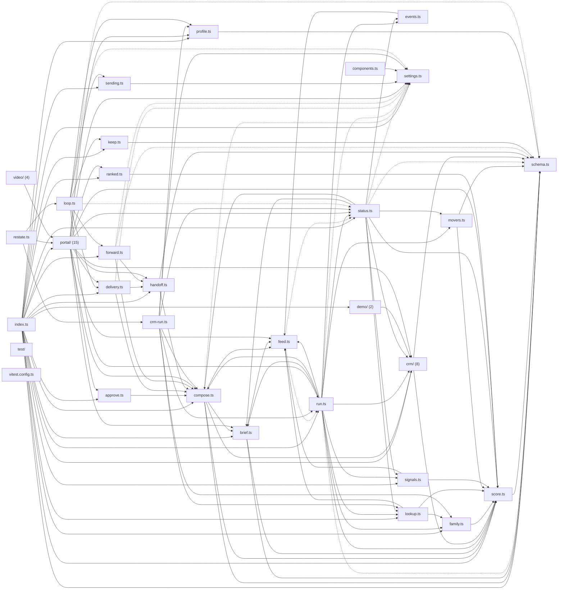

# @wren/reactivation

Role: package. Files: 57.

## Uses

- @wren/channel-email
- @wren/db
- @wren/core
- @wren/llm
- @wren/research
- @wren/connectors
- @wren/delivery
- @wren/video
- @wren/offers

## Outside packages

node:crypto, node:fs, node:path

## Folders

Dotted: types only.

## Files

- approve.ts
- brief.ts
- components.ts
- compose.ts
- crm-run.ts
- crm/: src/crm/dates.ts, src/crm/formats.ts, src/crm/health.ts, src/crm/import.ts, src/crm/job-orders.ts, src/crm/landing.ts, src/crm/source.ts, src/crm/verify.ts
- delivery.ts
- demo/: src/demo/history.ts, src/demo/seed.ts
- events.ts
- family.ts
- feed.ts
- forward.ts
- handoff.ts
- index.ts
- keep.ts
- lookup.ts
- loop.ts
- movers.ts
- portal/: src/portal/import-log.ts, src/portal/import.ts, src/portal/journey.ts, src/portal/mask.ts, src/portal/outbox.ts, src/portal/pipeline.ts, src/portal/record-views.ts, src/portal/records.ts, src/portal/routes.ts, src/portal/run.ts, src/portal/service.ts, src/portal/setup.ts, src/portal/story.ts, src/portal/views.ts, src/portal/work.ts
- profile.ts
- ranked.ts
- restate.ts
- run.ts
- schema.ts
- score.ts
- sending.ts
- settings.ts
- signals.ts
- status.ts
- test/: test/integration/demo-fixture.ts
- video/: src/video/brief.ts, src/video/index.ts, src/video/lead.ts, src/video/walk.ts
- vitest.config.ts
