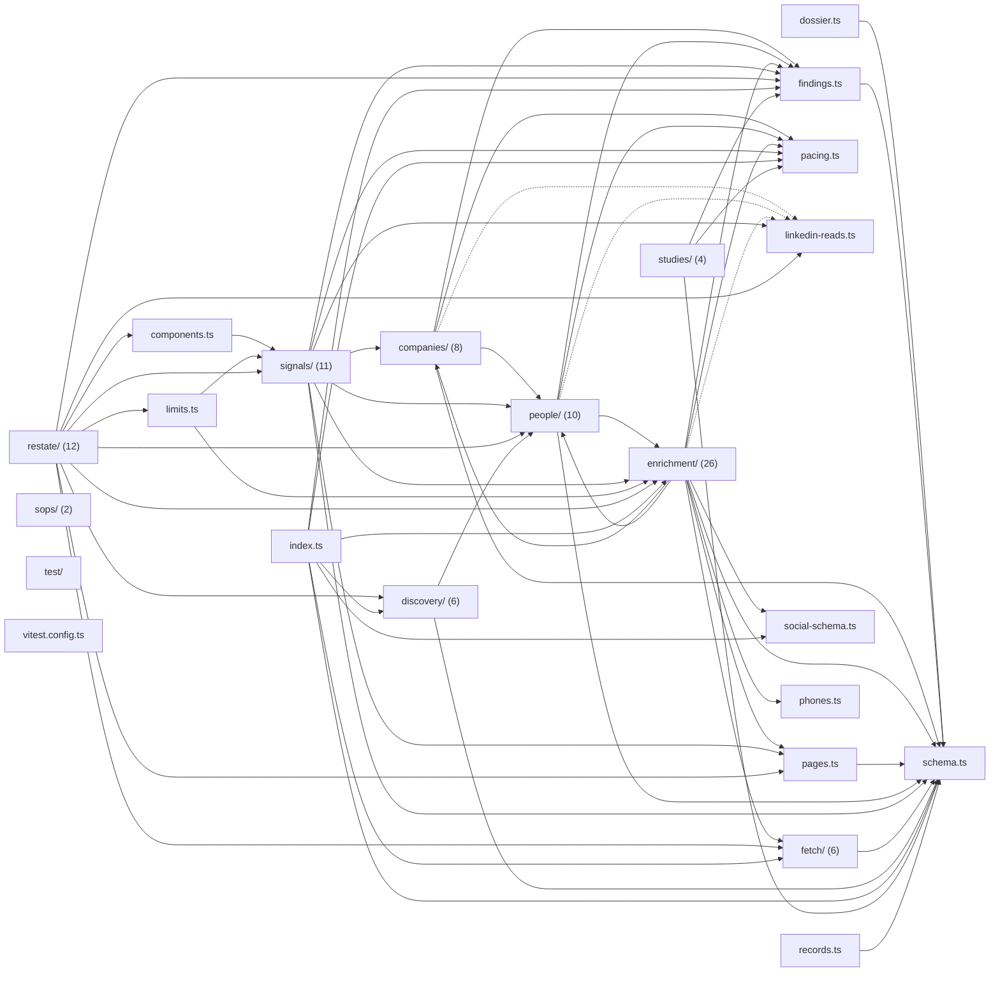

# @wren/research

Role: package. Files: 99.

## Uses

- @wren/core
- @wren/db
- @wren/llm

## Outside packages

node:crypto, node:dns, node:fs, node:path, node:stream, node:util, node:zlib

## Folders

Dotted: types only.

## Files

- companies/: src/companies/boards.ts, src/companies/customers.ts, src/companies/events.ts, src/companies/hiring.ts, src/companies/index.ts, src/companies/ppp-size.ts, src/companies/profile.ts, src/companies/store.ts
- components.ts
- discovery/: src/discovery/candidates.ts, src/discovery/find.ts, src/discovery/gate.ts, src/discovery/homepage.ts, src/discovery/index.ts, src/discovery/service.ts
- dossier.ts
- enrichment/: src/enrichment/ad-library.ts, src/enrichment/audit-backfill.ts, src/enrichment/contacts.ts, src/enrichment/crawler.ts, src/enrichment/email-pick/graph.ts, src/enrichment/email-pick/run.ts, src/enrichment/email-scan.ts, src/enrichment/exa-search.ts, src/enrichment/extraction.ts, src/enrichment/fb-groups.ts, src/enrichment/index.ts, src/enrichment/instagram.ts, src/enrichment/news-triggers.ts, src/enrichment/opener.ts, src/enrichment/profiles.ts, src/enrichment/readings.ts, src/enrichment/remote-browser.ts, src/enrichment/render.ts, src/enrichment/shard.ts, src/enrichment/shared-pages.ts, src/enrichment/store.ts, src/enrichment/team.ts, src/enrichment/testimonials.ts, src/enrichment/urls.ts, src/enrichment/youtube-search.ts, src/enrichment/youtube.ts
- fetch/: src/fetch/datasets.ts, src/fetch/index.ts, src/fetch/overture.ts, src/fetch/ppp.ts, src/fetch/sba.ts, src/fetch/tier-memory.ts
- findings.ts
- index.ts
- limits.ts
- linkedin-reads.ts
- pacing.ts
- pages.ts
- people/: src/people/contacts.ts, src/people/elsewhere.ts, src/people/fit-traits.ts, src/people/index.ts, src/people/lookup.ts, src/people/names.ts, src/people/profile-link.ts, src/people/profile-research.ts, src/people/store.ts, src/people/team.ts
- phones.ts
- records.ts
- restate/: src/restate/discovery.ts, src/restate/enrichment-context.ts, src/restate/enrichment-crawl.ts, src/restate/enrichment-people.ts, src/restate/enrichment-picks.ts, src/restate/enrichment-search.ts, src/restate/enrichment-social.ts, src/restate/enrichment.ts, src/restate/index.ts, src/restate/page-archive.ts, src/restate/profile-research.ts, src/restate/units.ts
- schema.ts
- signals/: src/signals/collectors.ts, src/signals/demand.ts, src/signals/funding.ts, src/signals/hiring.ts, src/signals/index.ts, src/signals/linkedin.ts, src/signals/news.ts, src/signals/site.ts, src/signals/stack-prints.ts, src/signals/stack.ts, src/signals/talks.ts
- social-schema.ts
- sops/: src/sops/cites.ts, src/sops/index.ts
- studies/: src/studies/index.ts, src/studies/plan.ts, src/studies/recipes.ts, src/studies/run.ts
- test/: test/integration/fixtures.ts
- vitest.config.ts
