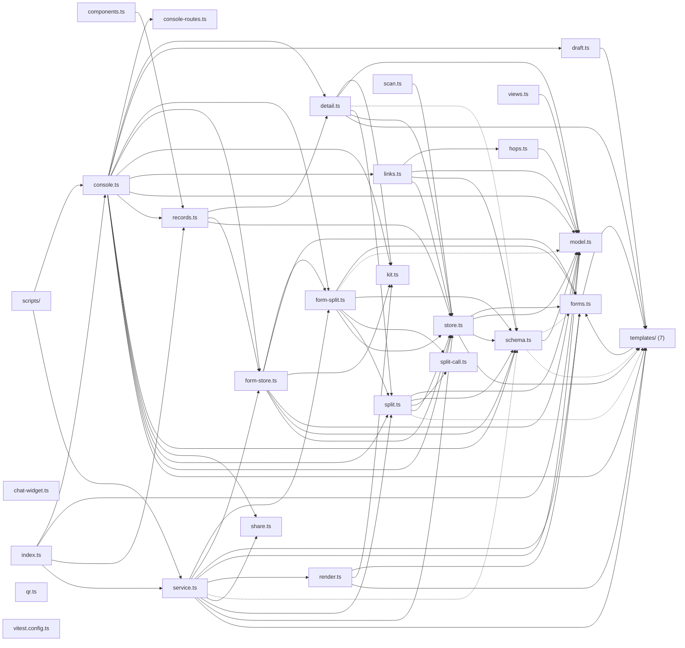

# @wren/sites

Role: package. Files: 34.

## Uses

- @wren/core
- @wren/db
- @wren/experiments
- @wren/offers

## Outside packages

@restatedev/restate-sdk@1.17.1, drizzle-orm@0.45.2, node:crypto, zod@4.6.5

## Folders

Dotted: types only.

## Files

- chat-widget.ts
- components.ts
- console-routes.ts
- console.ts
- detail.ts
- draft.ts
- form-split.ts
- form-store.ts
- forms.ts
- hops.ts
- index.ts
- kit.ts
- links.ts
- model.ts
- qr.ts
- records.ts
- render.ts
- scan.ts
- schema.ts
- scripts/: scripts/seed-preview.ts
- service.ts
- share.ts
- split-call.ts
- split.ts
- store.ts
- templates/: src/templates/index.ts, src/templates/lander.ts, src/templates/listicle.ts, src/templates/page.ts, src/templates/parts.ts, src/templates/sections.ts, src/templates/types.ts
- views.ts
- vitest.config.ts
