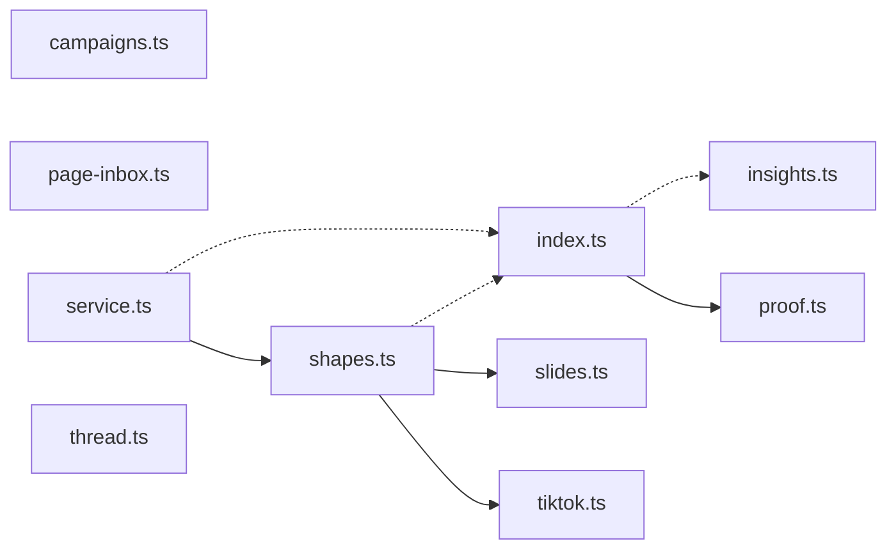

# @wren/starling-core

Role: package. Files: 10.

## Uses

- @wren/core

## Outside packages

@restatedev/restate-sdk@1.17.1, zod@4.6.5

## Folders

Dotted: types only.

## Files

- campaigns.ts
- index.ts
- insights.ts
- page-inbox.ts
- proof.ts
- service.ts
- shapes.ts
- slides.ts
- thread.ts
- tiktok.ts
