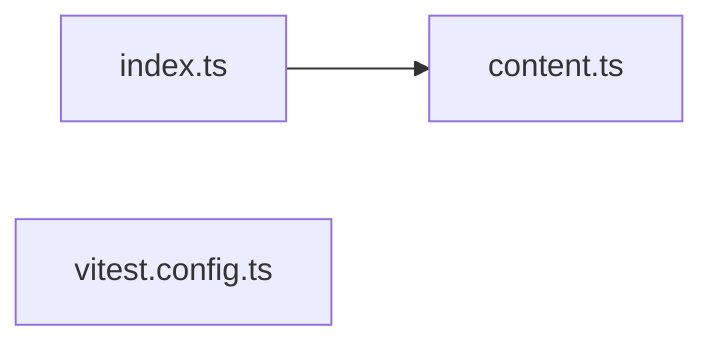

# @wren/starling-youtube

Role: package. Files: 3.

## Uses

- @wren/core (types only)
- @wren/starling-core

## Outside packages

vitest@5.0.1

## Folders

Dotted: types only.

## Files

- content.ts
- index.ts
- vitest.config.ts
