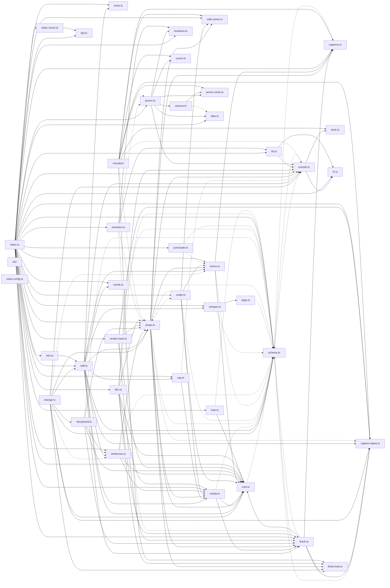

# @wren/studio

Role: package. Files: 42.

## Uses

- @wren/db
- @wren/core
- @wren/video

## Outside packages

node:child_process, node:crypto, node:fs, node:module, node:os, node:path, node:stream, node:url, node:util

## Folders

Dotted: types only.

## Files

- align.ts
- bar.ts
- camera.ts
- cap.ts
- caption-styles.ts
- captions.ts
- change.ts
- cursor.ts
- cuts.ts
- duck.ts
- edit.ts
- film.ts
- finish-look.ts
- finish.ts
- fx.ts
- index.ts
- kit.ts
- locks.ts
- look.ts
- loudness.ts
- matte.ts
- media.ts
- obs.ts
- promo-clock.ts
- promo.ts
- props.ts
- punctuate.ts
- remotion.ts
- remotion/: remotion/index.tsx
- render-hash.ts
- safe-zones.ts
- schema.ts
- sentences.ts
- sfx/: sfx/make.mjs
- sounds.ts
- storyboard.ts
- stress.ts
- take.ts
- video-check.ts
- vitest.config.ts
- whisper.ts
- words.ts
