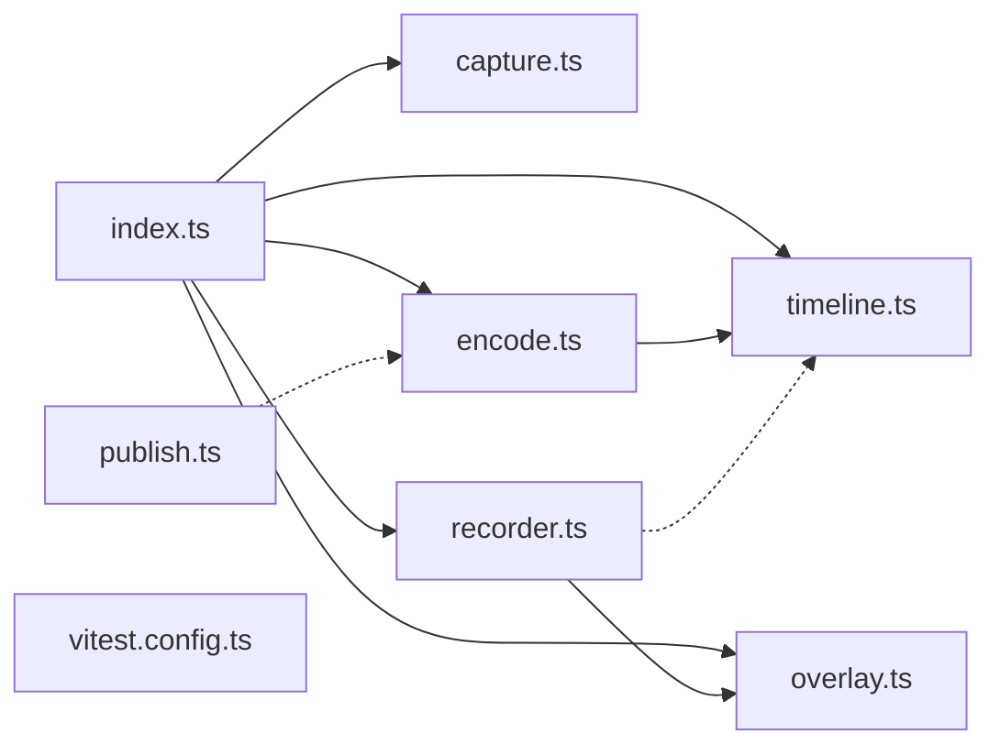

# @wren/video

Role: package. Files: 8.

## Uses

- @wren/db

## Outside packages

node:child_process, node:crypto, node:fs, node:path

## Folders

Dotted: types only.

## Files

- capture.ts
- encode.ts
- index.ts
- overlay.ts
- publish.ts
- recorder.ts
- timeline.ts
- vitest.config.ts
