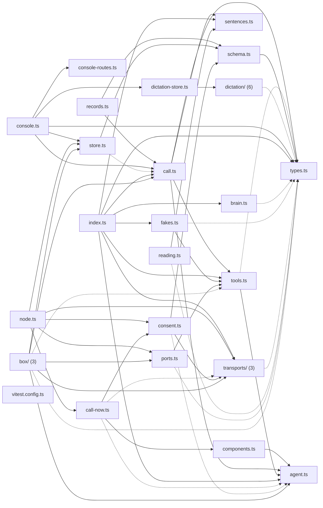

# @wren/voice

Role: package. Files: 33.

## Uses

- @wren/core
- @wren/db
- @wren/channel-sms
- @wren/calendar
- @wren/config

## Outside packages

node:crypto, node:http, node:stream

## Folders

Dotted: types only.

## Files

- agent.ts
- box/: src/box/main.ts, src/box/server.ts, src/box/ws.ts
- brain.ts
- call-now.ts
- call.ts
- components.ts
- consent.ts
- console-routes.ts
- console.ts
- dictation-store.ts
- dictation/: src/dictation/commands.ts, src/dictation/ears.ts, src/dictation/index.ts, src/dictation/route.ts, src/dictation/session.ts, src/dictation/transcriber.ts
- fakes.ts
- index.ts
- node.ts
- ports.ts
- reading.ts
- records.ts
- schema.ts
- sentences.ts
- store.ts
- tools.ts
- transports/: src/transports/browser.ts, src/transports/telnyx.ts, src/transports/text.ts
- types.ts
- vitest.config.ts
