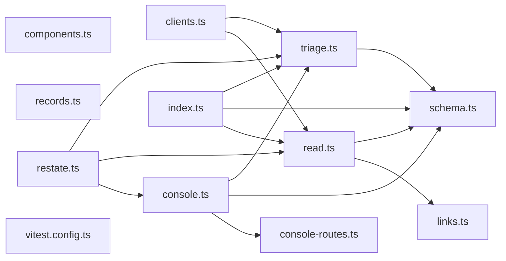

# @wren/watch

Role: package. Files: 12.

## Uses

- @wren/core
- @wren/db
- @wren/learn
- @wren/llm

## Outside packages

@restatedev/restate-sdk@1.17.1, drizzle-orm@0.45.2, zod@4.6.5

## Folders

Dotted: types only.

## Files

- clients.ts
- components.ts
- console-routes.ts
- console.ts
- index.ts
- links.ts
- read.ts
- records.ts
- restate.ts
- schema.ts
- triage.ts
- vitest.config.ts
