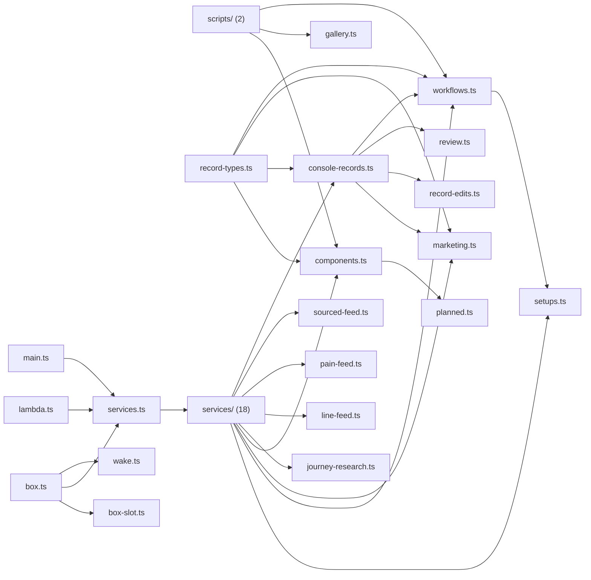

# @wren/worker

Role: package. Files: 40.

## Uses

- @wren/books
- @wren/calendar
- @wren/channel-email
- @wren/channel-linkedin
- @wren/channel-meta
- @wren/channel-reddit
- @wren/channel-search
- @wren/channel-sms
- @wren/channel-tiktok
- @wren/channel-x
- @wren/channel-youtube
- @wren/config
- @wren/connectors
- @wren/content
- @wren/core
- @wren/db
- @wren/delivery
- @wren/documents
- @wren/learn
- @wren/llm
- @wren/niches
- @wren/notes
- @wren/offers
- @wren/outreach
- @wren/payments
- @wren/pipeline
- @wren/reactivation
- @wren/research
- @wren/sites
- @wren/voice
- @wren/watch

## Outside packages

node:child_process, node:fs, node:http2, node:path, node:url

## Folders

Dotted: types only.

## Files

- box-slot.ts
- box.ts
- components.ts
- console-records.ts
- gallery.ts
- journey-research.ts
- lambda.ts
- line-feed.ts
- main.ts
- marketing.ts
- pain-feed.ts
- planned.ts
- record-edits.ts
- record-types.ts
- review.ts
- scripts/: scripts/build-lambda.mjs, scripts/gallery-export.ts
- services.ts
- services/: src/services/accounts.ts, src/services/apps.ts, src/services/books.ts, src/services/calendar.ts, src/services/clients.ts, src/services/content-channels.ts, src/services/content.ts, src/services/deps.ts, src/services/email.ts, src/services/executor.ts, src/services/people.ts, src/services/platform.ts, src/services/reach.ts, src/services/reactivation.ts, src/services/research.ts, src/services/search.ts, src/services/sms.ts, src/services/watch.ts
- setups.ts
- sourced-feed.ts
- wake.ts
- workflows.ts
